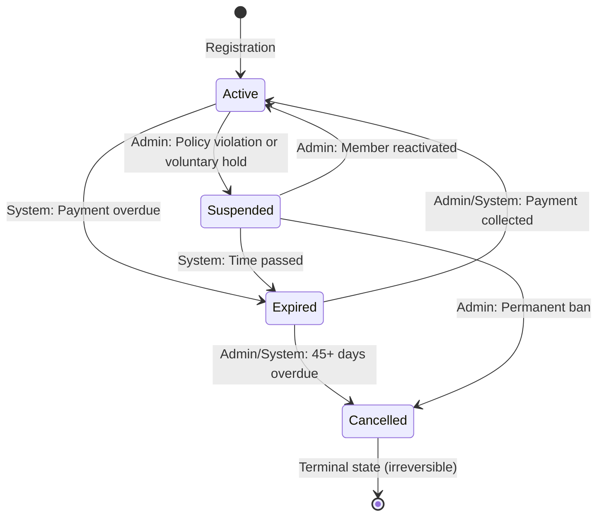
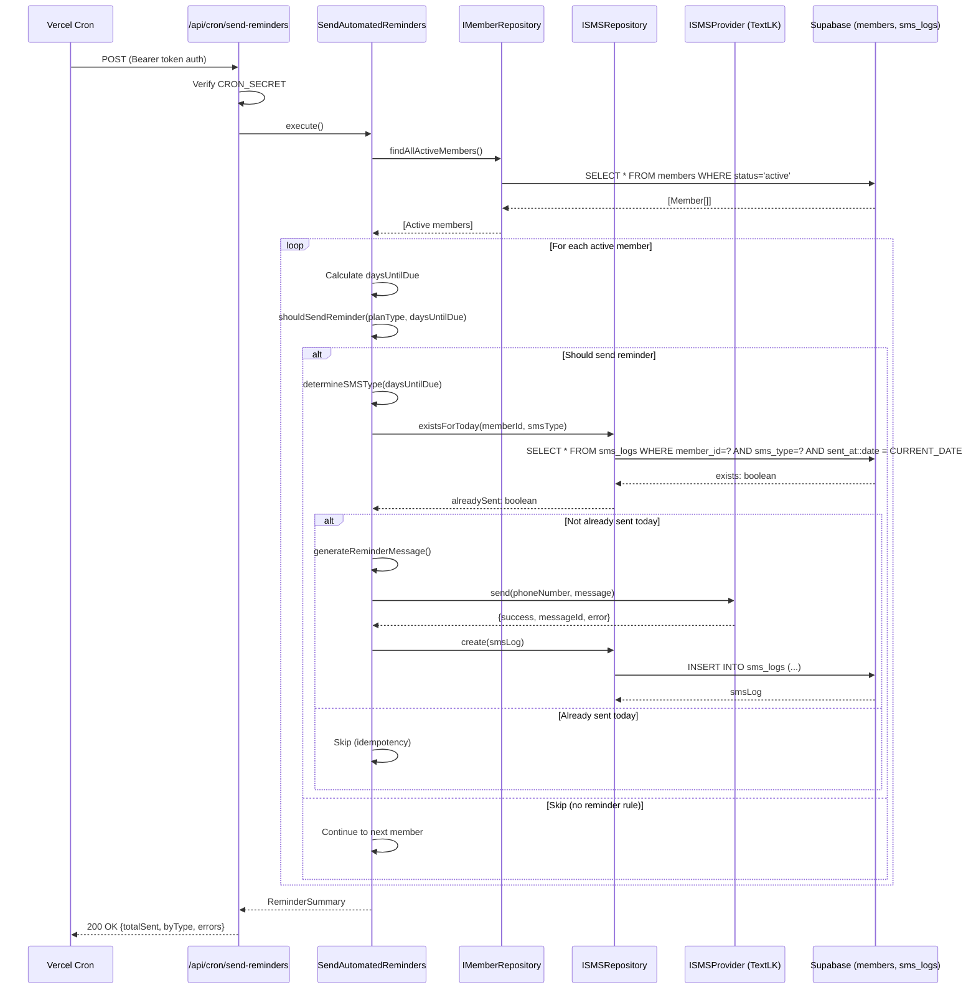
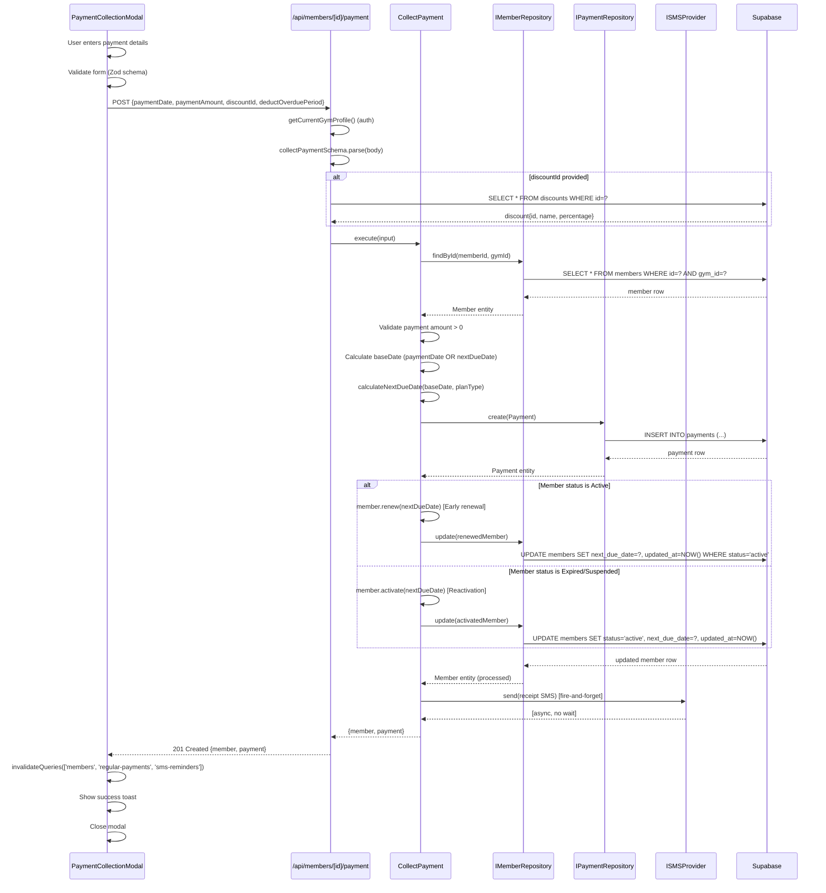
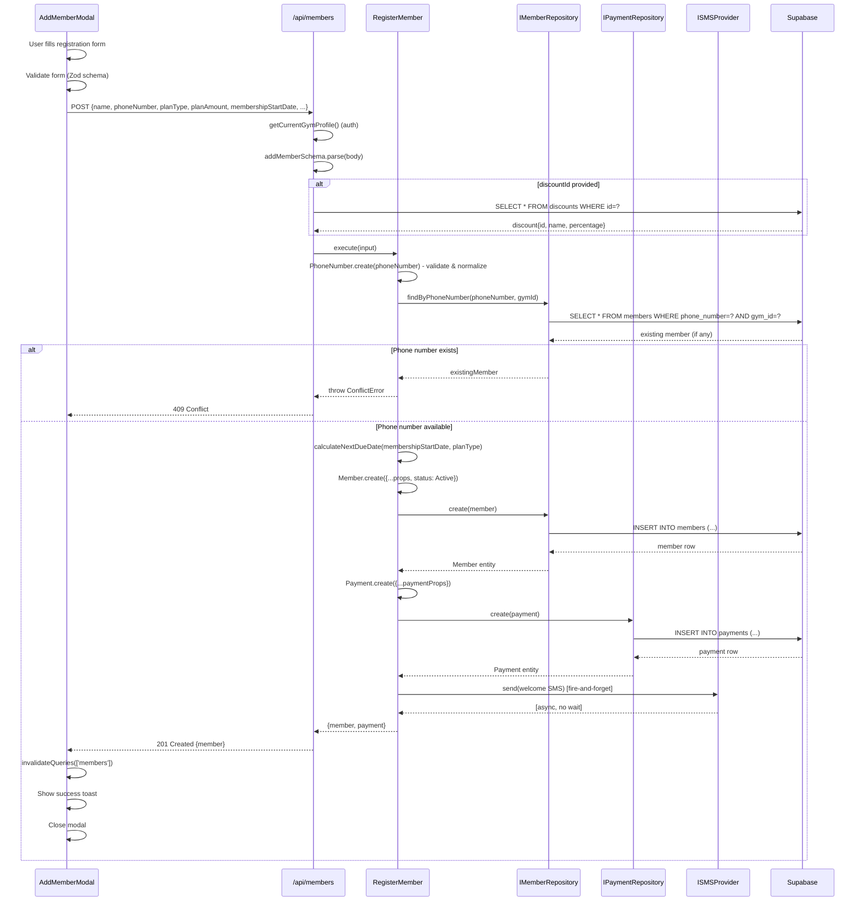
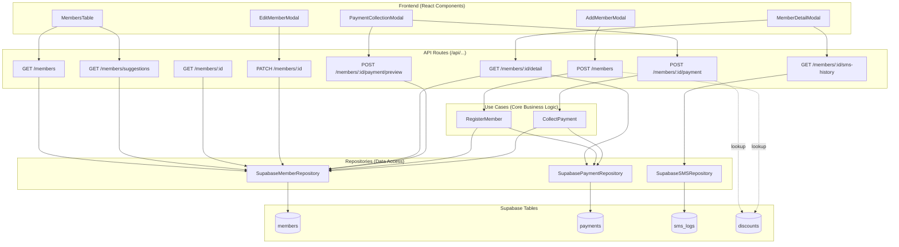
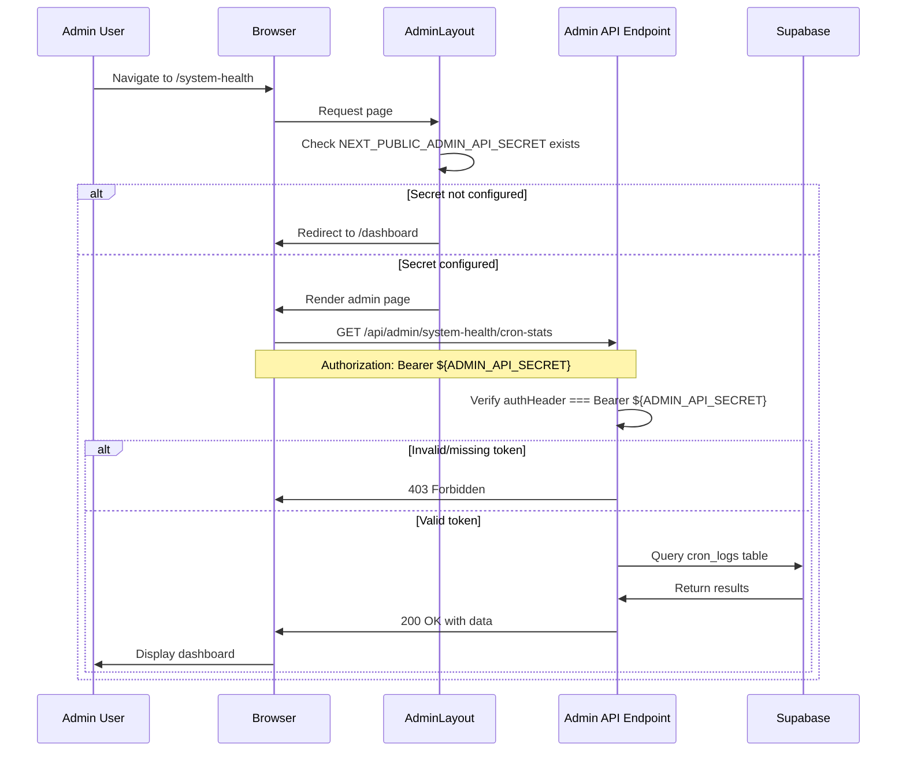

# SYSTEM MANUAL: Gym Management SaaS
## Comprehensive Technical Audit & Operational Documentation

**Generated**: 2026-03-26
**Last Updated**: 2026-03-28 (Phase 5: Observability & Monitoring - Dual-layer architecture with user-facing error tracking and SaaS admin monitoring dashboard completed)
**Architecture**: Clean Architecture (Hexagonal) + Feature-First Organization + Dual-Layer Observability
**Stack**: Next.js 16 (App Router), TypeScript, Supabase (PostgreSQL), React 19

---

## Table of Contents

1. [Phase 1: State Machine & Domain Logic](#phase-1-state-machine--domain-logic)
2. [Phase 2: Execution Vector Tracing](#phase-2-execution-vector-tracing)
3. [Phase 3: Frontend-to-Backend Topology](#phase-3-frontend-to-backend-topology)
4. [Phase 4: Gap & Orphan Analysis](#phase-4-gap--orphan-analysis)
5. [Phase 5: Observability & Monitoring](#phase-5-observability--monitoring)
6. [Appendix: Quick Reference](#appendix-quick-reference)

---

# Phase 1: State Machine & Domain Logic

## 1.1 Member Status State Machine

### Status Enum Definition
**Location**: `src/core/utils/constants/StatusConfig.ts:11-34`

```typescript
enum MemberStatus {
  Active = 'active',      // Valid payment, can check in
  Expired = 'expired',    // Payment overdue
  Suspended = 'suspended',// Policy violation or voluntary hold
  Cancelled = 'cancelled' // Terminal state (permanent)
}
```

### Database Schema
**Location**: `supabase/migrations/20260326000001_remove_frozen_status.sql`

```sql
CREATE TYPE member_status AS ENUM ('active', 'expired', 'suspended', 'cancelled');
```

**Note**: The `frozen` status was removed on 2026-03-26. All frozen members were migrated to `suspended` status. The `suspended` status now handles both policy violations AND voluntary membership holds.

---

## 1.2 Complete Status Transition Matrix

### Valid Transitions (7 Total)

**Source**: `src/core/utils/constants/StatusConfig.ts:81-133`



| From | To | Trigger | Who Can Execute | Requires Reason | Description |
|------|------|---------|----------------|----------------|-------------|
| **Active** | Expired | Payment overdue | System | No | Automatic when `next_due_date` < today |
| **Active** | Suspended | Policy violation or voluntary hold | Admin | No | Member suspended by admin or voluntary freeze |
| **Expired** | Active | Payment collected | Admin, System | No | Member paid outstanding amount |
| **Expired** | Cancelled | 45+ days overdue | Admin, System | No | Long-term non-payment |
| **Suspended** | Active | Member reactivated | Admin | No | Admin reactivates member |
| **Suspended** | Expired | Time passed | System | No | Suspended + payment due passed |
| **Suspended** | Cancelled | Permanent ban | Admin | Yes | Severe violation or member request |

**Key Changes** (2026-03-26):
- **Reduced from 11 to 7 transitions**: Removed all frozen-related paths
- **Suspended semantics updated**: Now encompasses both policy violations and voluntary holds (formerly "frozen")
- **Visual clarity**: Suspended members show yellow badge (requires attention) instead of gray

---

## 1.2.1 Early Renewal Operation (Active → Active)

### Definition
**Location**: `src/core/domain/member/Member.ts:320-333`

Early renewal is **not a state transition** but a subscription extension operation for already active members. This allows members to pay before their due date and extend their subscription without changing their status.

### Member.renew() Method

```typescript
/**
 * Renew member (early renewal)
 *
 * Extends an already active member's subscription by updating their next due date.
 * This is used when an active member pays early (before their current subscription expires).
 *
 * @param newDueDate - The new next due date
 * @returns New Member instance with updated due date (status remains Active)
 * @throws InvalidStatusTransitionError if member is not Active
 */
renew(newDueDate: Date): Member {
  if (this.props.status !== MemberStatus.Active) {
    throw new InvalidStatusTransitionError(
      this.props.status,
      MemberStatus.Active
    );
  }

  return new Member({
    ...this.props,
    nextDueDate: newDueDate,
    updatedAt: new Date(),
  });
}
```

### Use Cases

| Scenario | Current Status | Due Date | Action | Method | Result |
|----------|---------------|----------|--------|--------|--------|
| **Early Payment** | Active | Jan 31 | Pay on Jan 15 | `renew()` | Status: Active, Due: Feb 15 |
| **Subscription Extension** | Active | Feb 28 | Pay on Feb 20 | `renew()` | Status: Active, Due: Mar 20 |
| **Overdue Payment** | Expired | Jan 31 (past) | Pay on Feb 15 | `activate()` | Status: Active, Due: Mar 15 |

### Database Mutations

**Table**: `members`

```sql
-- Early renewal (Active → Active)
UPDATE members
SET
  next_due_date = ?,  -- Extended due date
  updated_at = NOW()
WHERE id = ? AND gym_id = ? AND status = 'active';
-- Note: Status remains 'active', no state transition
```

**Contrast with Reactivation**:
```sql
-- Reactivation (Expired/Suspended → Active)
UPDATE members
SET
  status = 'active',  -- State transition occurs
  next_due_date = ?,
  updated_at = NOW()
WHERE id = ? AND gym_id = ?;
```

### Implementation Context

**Payment Collection Logic** (`CollectPayment.ts:187-190`):
```typescript
const processedMember =
  member.status === 'active'
    ? member.renew(nextDueDate)        // Early renewal (no state change)
    : member.activate(nextDueDate);     // Reactivation (state transition)
```

**Benefits**:
- ✅ **Prevents Invalid Transition Error**: `activate()` rejects `Active → Active` transitions
- ✅ **Explicit Intent**: Code clearly distinguishes renewal from reactivation
- ✅ **Audit Trail**: Database logs show whether payment was early renewal or reactivation
- ✅ **Business Logic Clarity**: State machine remains intact with 7 transitions only

---

## 1.3 SUSPENDED Status: Comprehensive Overview

### Definition
**Location**: `src/core/utils/constants/StatusConfig.ts:23-27`

```typescript
/**
 * Member has been suspended for policy violation or voluntary hold
 * Requires admin intervention to reactivate
 */
Suspended = 'suspended'
```

### Use Cases

#### 1. **Policy Violation** (Admin-Initiated)
- Member violated gym rules (e.g., harassment, unauthorized access)
- Requires admin action to resolve and reactivate
- May include notes/reason in admin panel

#### 2. **Voluntary Hold** (Member-Requested)
- Member requests temporary pause (e.g., travel, injury, financial hardship)
- Admin processes the request and suspends membership
- Member can request reactivation when ready

### Triggers (When Applied)

**Manual Trigger - Admin Action**
- **UI Location**: `src/components/members/EditMemberModal.tsx` (Status dropdown)
- **API Route**: `PATCH /api/members/[id]` with `{ status: 'suspended' }`
- **Domain Method**: `Member.suspend()` in `src/core/domain/member/Member.ts:337`
- **State Machine Check**: `canTransition(Active, Suspended)` → returns `true`

### Database Mutations When Applied

**Location**: `src/infrastructure/database/repositories/SupabaseMemberRepository.ts:293-319`

```sql
UPDATE members
SET
  status = 'suspended',
  updated_at = NOW()
WHERE id = ? AND gym_id = ?;
```

**Fields Changed**:
- `status`: `'active'` → `'suspended'`
- `updated_at`: Current timestamp

**Fields NOT Changed**:
- `next_due_date`: Remains unchanged (important: suspension doesn't extend billing cycle by default)
- `plan_amount`: Unchanged
- `plan_type`: Unchanged

### Frontend Behavior When Suspended

**UI Components Affected**:

1. **Member Directory** (`src/components/members/MembersTable.tsx`)
   - **Status Badge**: Shows yellow badge with "Suspended" label
   - **Status Filter**: Can filter to show only suspended members
   - **Click Behavior**: Opens member detail modal

2. **Payment Collection Modal** (`src/components/members/PaymentCollectionModal.tsx`)
   - **Restriction**: None - admins can collect payment to reactivate
   - **Payment Button**: Enabled
   - **Behavior**: Collecting payment transitions Suspended → Active automatically

3. **Member Detail Modal**
   - **Edit Status Dropdown**: Shows "Suspended" as selectable option
   - **Allowed Transitions**:
     - Suspended → Active (Reactivate)
     - Suspended → Cancelled (Permanent cancellation)
     - Suspended → Expired (Time passes while suspended)
   - **Blocked Transitions**:
     - Suspended → Suspended (no-op, invalid)

### Cron Job Handling of Suspended Status

#### 1. Send Reminders Cron (`/api/cron/send-reminders`)
**Location**: `src/core/use-cases/reminder/SendAutomatedReminders.ts:119-122`

```typescript
// Get ACTIVE members only
const members = input.gymId
  ? await this.memberRepo.findActiveMembers(input.gymId)
  : await this.memberRepo.findAllActiveMembers();
```

**Result**: Suspended members receive **ZERO** payment reminders (not in active list).

#### 2. Update Expired Status Cron (`/api/cron/update-expired-status`)
**Location**: `src/core/use-cases/member/UpdateExpiredStatus.ts:84-91`

```typescript
// Filter members whose next_due_date < today
const overdueMembers = activeMembers.filter((member) => {
  const dueDate = new Date(member.nextDueDate);
  dueDate.setHours(0, 0, 0, 0);
  return dueDate < today;
});
```

**Result**: Suspended members **do NOT** auto-expire via this cron (only active members).

**However**: If a suspended member's `next_due_date` passes, they can transition to expired via the `Suspended → Expired` path, but this is **not currently automated**. This is a potential gap for members suspended for extended periods.

#### 3. Cancel Overdue Members Cron (`/api/cron/cancel-overdue-members`)
**Location**: `src/core/use-cases/member/CancelOverdueMembers.ts:103`

```typescript
const expiredMembers = await this.getAllExpiredMembersAcrossGyms();
```

**Result**: Suspended members **cannot** be auto-cancelled by this cron (only expired members).

### Transitions Out of Suspended

**Location**: `src/core/utils/constants/StatusConfig.ts:111-133`

| To | Method | Trigger | Files Involved |
|----|--------|---------|----------------|
| **Active** | `member.activate(newDueDate)` | Admin reactivates + optional payment | `Member.ts:296`, `CollectPayment.ts:183` |
| **Expired** | `member.expire()` | System (time passed while suspended) | `Member.ts:317` |
| **Cancelled** | `member.cancel()` | Admin/User cancels membership | `Member.ts:337`, API: `PATCH /api/members/[id]` |

---

## 1.4 Plan Type Configuration

### Plan Enum Definition
**Location**: `src/core/utils/constants/PlanConfig.ts:11-19`

```typescript
enum PlanType {
  Daily = 'daily',
  Weekly = 'weekly',
  Monthly = 'monthly',
  ThreeMonths = '3-months',
  SixMonths = '6-months',
  Annual = 'annual',
  Custom = 'custom'
}
```

### Database Schema
**Location**: `supabase/migrations/20260325000001_sync_enums_and_drop_reminder_columns.sql:14-17`

```sql
ALTER TYPE member_plan_type ADD VALUE IF NOT EXISTS 'weekly';
ALTER TYPE member_plan_type ADD VALUE IF NOT EXISTS '3-months';
ALTER TYPE member_plan_type ADD VALUE IF NOT EXISTS '6-months';
ALTER TYPE member_plan_type ADD VALUE IF NOT EXISTS 'custom';
```

### Plan Configuration Matrix

**Location**: `src/core/utils/constants/PlanConfig.ts:79-142`

| Plan Type | Duration (Days) | Duration Method | Duration Value | Suggested Min (LKR) | Recurring Discount |
|-----------|----------------|-----------------|----------------|-------------------|-------------------|
| **Daily** | 1 | `day` | 1 | 100 | No |
| **Weekly** | 7 | `day` | 7 | 500 | Yes |
| **Monthly** | ~30 | `month` | 1 | 1,500 | Yes |
| **3-Months** | ~90 | `month` | 3 | 4,000 | Yes |
| **6-Months** | ~180 | `month` | 6 | 7,500 | Yes |
| **Annual** | ~365 | `year` | 1 | 14,000 | Yes |
| **Custom** | 30 (default) | `month` | 1 | 1,000 | Yes |

**Duration Calculation Logic**: `src/core/utils/date/calculateNextDueDate.ts`

```typescript
function calculateNextDueDate(baseDate: Date, planType: PlanType): Date {
  const config = getPlanConfig(planType);
  const nextDue = new Date(baseDate);

  switch (config.durationMethod) {
    case 'day':
      nextDue.setDate(nextDue.getDate() + config.durationValue);
      break;
    case 'month':
      nextDue.setMonth(nextDue.getMonth() + config.durationValue);
      break;
    case 'year':
      nextDue.setFullYear(nextDue.getFullYear() + config.durationValue);
      break;
  }
  return nextDue;
}
```

---

## 1.5 Reminder Rules by Plan Type

**Location**: `src/core/utils/constants/ReminderConfig.ts:56-123`

### Reminder Matrix

| Plan Type | 7-Day Reminder | 3-Day Reminder | Due Today | Overdue | Rationale |
|-----------|----------------|----------------|-----------|---------|-----------|
| **Daily** | ❌ | ❌ | ❌ | ❌ | Too frequent (payments every day) |
| **Weekly** | ✅ | ✅ | ✅ | ✅ | All reminders applicable |
| **Monthly** | ❌ | ✅ | ✅ | ✅ | Skip 7-day (only 30-day cycle) |
| **3-Months** | ✅ | ✅ | ✅ | ✅ | Long-term plan, all reminders |
| **6-Months** | ✅ | ✅ | ✅ | ✅ | Long-term plan, all reminders |
| **Annual** | ✅ | ✅ | ✅ | ✅ | Long-term plan, all reminders |
| **Custom** | ✅ | ✅ | ✅ | ✅ | Default to all reminders |

**Implementation**:

```typescript
export const REMINDER_RULES: Record<PlanType, ReminderRule> = {
  [PlanType.Daily]: {
    reminderDays: [],
    enabledReminders: [], // NO automatic reminders
  },
  [PlanType.Monthly]: {
    reminderDays: [3, 0], // SKIP 7-day reminder
    enabledReminders: [
      ReminderType.ThreeDay,
      ReminderType.DueToday,
      ReminderType.Overdue,
    ],
  },
  // ... others with [7, 3, 0] reminder days
};
```

---

# Phase 2: Execution Vector Tracing

## 2.1 Process A: Automated Reminders

### Trigger
- **Cron Schedule**: Daily at 9:00 AM Sri Lanka Time (3:30 AM UTC)
- **Vercel Cron Config**: `vercel.json` (if using Vercel)
- **Alternative**: Manual trigger via `GET /api/cron/send-reminders` (dev only)

### Execution Flow



### File Trace

| Step | File | Line Range | Function | Description |
|------|------|-----------|----------|-------------|
| 1 | `src/app/api/cron/send-reminders/route.ts` | 10-59 | `POST()` | Cron endpoint, auth verification |
| 2 | `src/infrastructure/di/index.ts` | - | `getAdminContainer()` | Dependency injection container |
| 3 | `src/core/use-cases/reminder/SendAutomatedReminders.ts` | 104-161 | `execute()` | Main orchestration logic |
| 4 | `src/infrastructure/database/repositories/SupabaseMemberRepository.ts` | 174-185 | `findAllActiveMembers()` | Query active members |
| 5 | `src/core/utils/date/getDaysUntilDue.ts` | - | `getDaysUntilDue()` | Calculate days until due |
| 6 | `src/core/utils/constants/ReminderConfig.ts` | 155-175 | `shouldSendReminder()` | Check if reminder needed |
| 7 | `src/core/use-cases/reminder/SendAutomatedReminders.ts` | 220-231 | `determineSMSType()` | Map days to SMS type |
| 8 | `src/infrastructure/database/repositories/SupabaseSMSRepository.ts` | - | `existsForToday()` | Duplicate check |
| 9 | `src/core/use-cases/reminder/SendAutomatedReminders.ts` | 285-316 | `generateReminderMessage()` | SMS body generation |
| 10 | `src/infrastructure/external/TextLKSMSProvider.ts` | - | `send()` | External API call |
| 11 | `src/infrastructure/database/repositories/SupabaseSMSRepository.ts` | - | `create()` | Log to sms_logs table |

### Database Mutations

**Table**: `sms_logs`

```sql
INSERT INTO sms_logs (
  member_id,
  gym_id,
  sms_type,
  phone_number,
  message_body,
  sent_at,
  delivery_status,
  textlk_message_id,
  error_message
) VALUES (?, ?, ?, ?, ?, NOW(), 'sent'|'failed', ?, ?);
```

**Table**: `members` (No changes - read-only for this process)

### Validation Steps

1. **Auth**: `authHeader === 'Bearer ' + CRON_SECRET`
2. **Member Status**: Only `status = 'active'` members included
3. **Plan Type Check**: `shouldSendReminder(planType, daysUntilDue)` validates plan-specific rules
4. **Duplicate Prevention**: `existsForToday(memberId, smsType)` ensures max 1 reminder/type/day
5. **SMS Provider Validation**: TextLK API validates phone number format

---

## 2.2 Process B: Payment Collection

### Trigger
- **UI**: Payment Collection Modal (`src/components/members/PaymentCollectionModal.tsx`)
- **User Action**: Admin clicks "Collect Payment" button for an overdue member
- **API Call**: `POST /api/members/[id]/payment`

### Execution Flow



### File Trace

| Step | File | Line Range | Function | Description |
|------|------|-----------|----------|-------------|
| 1 | `src/components/members/PaymentCollectionModal.tsx` | 91-122 | `collectPaymentMutation` | Form submission handler |
| 2 | `src/app/api/members/[id]/payment/route.ts` | 12-110 | `POST()` | API endpoint |
| 3 | `src/lib/middleware/auth.ts` | - | `getCurrentGymProfile()` | Supabase auth check |
| 4 | `src/features/members/schemas/member.schemas.ts` | - | `collectPaymentSchema` | Zod validation |
| 5 | `src/core/use-cases/payment/CollectPayment.ts` | 144-204 | `execute()` | Main business logic (with renew/activate conditional) |
| 6 | `src/infrastructure/database/repositories/SupabaseMemberRepository.ts` | 64-81 | `findById()` | Member lookup |
| 7 | `src/core/utils/date/calculateNextDueDate.ts` | - | `calculateNextDueDate()` | Date calculation |
| 8 | `src/infrastructure/database/repositories/SupabasePaymentRepository.ts` | - | `create()` | Payment insert |
| 9 | `src/core/domain/member/Member.ts` | 288-298, 320-333 | `activate()` / `renew()` | State transition or renewal |
| 10 | `src/infrastructure/database/repositories/SupabaseMemberRepository.ts` | 293-319 | `update()` | Member status update |
| 11 | `src/infrastructure/external/TextLKSMSProvider.ts` | - | `send()` | Receipt SMS (async) |

### Database Mutations

**Table**: `payments`

```sql
INSERT INTO payments (
  member_id,
  gym_id,
  payment_date,
  amount_paid,
  discount_applied,
  discount_percentage,
  next_due_date_calculated,
  created_at
) VALUES (?, ?, ?, ?, ?, ?, ?, NOW());
```

**Table**: `members`

```sql
UPDATE members
SET
  status = 'active',
  next_due_date = ?,  -- Calculated new due date
  updated_at = NOW()
WHERE id = ? AND gym_id = ?;
```

**Table**: `sms_logs` (async, fire-and-forget)

```sql
INSERT INTO sms_logs (
  member_id,
  gym_id,
  sms_type,
  phone_number,
  message_body,
  sent_at,
  delivery_status
) VALUES (?, ?, 'payment_receipt', ?, ?, NOW(), 'sent');
```

### Validation Steps

1. **Auth**: Verify JWT session via `getCurrentGymProfile()`
2. **Input Validation**: Zod schema validates:
   - `paymentDate` is valid date
   - `paymentAmount` > 0
   - `discountId` exists (if provided)
3. **Member Existence**: `findById()` throws NotFoundError if missing
4. **State Transition/Renewal**:
   - **If member is Active**: `member.renew()` updates due date (early renewal)
   - **If member is Expired/Suspended**: `member.activate()` validates transition via `canTransition(currentStatus, Active)`
5. **Payment Amount**: Must be > 0 (enforced by domain entity)

### Business Logic: Early Renewal vs Reactivation

**Location**: `src/core/use-cases/payment/CollectPayment.ts:187-190`

```typescript
const processedMember =
  member.status === 'active'
    ? member.renew(nextDueDate)        // Early renewal for active members
    : member.activate(nextDueDate);     // Reactivation for expired/suspended
```

**Use Cases**:
- **Early Renewal** (Active → Active): Member pays before due date, extends subscription
- **Reactivation** (Expired → Active): Member pays overdue amount, reactivates membership
- **Reactivation** (Suspended → Active): Member pays to lift suspension

---

## 2.3 Process C: Member Registration

### Trigger
- **UI**: Add Member Modal (`src/components/members/AddMemberModal.tsx`)
- **User Action**: Admin fills registration form and clicks "Register"
- **API Call**: `POST /api/members`

### Execution Flow



### File Trace

| Step | File | Line Range | Function | Description |
|------|------|-----------|----------|-------------|
| 1 | `src/components/members/AddMemberModal.tsx` | - | Form submission | User input |
| 2 | `src/app/api/members/route.ts` | 73-161 | `POST()` | API endpoint |
| 3 | `src/lib/middleware/auth.ts` | - | `getCurrentGymProfile()` | Auth verification |
| 4 | `src/features/members/schemas/member.schemas.ts` | - | `addMemberSchema` | Zod validation |
| 5 | `src/core/use-cases/member/RegisterMember.ts` | 137-202 | `execute()` | Main orchestration |
| 6 | `src/core/domain/value-objects/PhoneNumber.ts` | - | `PhoneNumber.create()` | Phone validation |
| 7 | `src/infrastructure/database/repositories/SupabaseMemberRepository.ts` | - | `findByPhoneNumber()` | Duplicate check |
| 8 | `src/core/utils/date/calculateNextDueDate.ts` | - | `calculateNextDueDate()` | Next due calculation |
| 9 | `src/core/domain/member/Member.ts` | 100-107 | `Member.create()` | Domain entity creation |
| 10 | `src/infrastructure/database/repositories/SupabaseMemberRepository.ts` | 271-288 | `create()` | Member insert |
| 11 | `src/infrastructure/database/repositories/SupabasePaymentRepository.ts` | - | `create()` | Initial payment record |
| 12 | `src/infrastructure/external/TextLKSMSProvider.ts` | - | `send()` | Welcome SMS (async) |

### Database Mutations

**Table**: `members`

```sql
INSERT INTO members (
  gym_id,
  name,
  phone_number,
  plan_type,
  plan_amount,
  discount_id,
  recurring_discount,
  status,
  registered_date,
  membership_start_date,
  next_due_date,
  created_at,
  updated_at
) VALUES (?, ?, ?, ?, ?, ?, ?, 'active', ?, ?, ?, NOW(), NOW());
```

**Table**: `payments`

```sql
INSERT INTO payments (
  member_id,
  gym_id,
  payment_date,
  amount_paid,
  discount_applied,
  discount_percentage,
  next_due_date_calculated,
  created_at
) VALUES (?, ?, ?, ?, ?, ?, ?, NOW());
```

**Table**: `sms_logs` (async, fire-and-forget)

```sql
INSERT INTO sms_logs (
  member_id,
  gym_id,
  sms_type,
  phone_number,
  message_body,
  sent_at,
  delivery_status
) VALUES (?, ?, 'welcome', ?, ?, NOW(), 'sent');
```

### Validation Steps

1. **Auth**: JWT session validation
2. **Input Validation**: Zod schema validates:
   - `name` length >= 2
   - `phoneNumber` matches Sri Lankan format (`+94XXXXXXXXX`)
   - `planType` is valid enum value
   - `planAmount` > 0
   - `membershipStartDate` is valid date
3. **Phone Number Normalization**: `PhoneNumber.create()` standardizes format
4. **Duplicate Check**: Query `findByPhoneNumber()` ensures unique phone per gym
5. **Domain Validation**: `Member.create()` enforces:
   - `gymId` not empty
   - `name` >= 2 characters
   - `phoneNumber` not empty
   - `planAmount` > 0

---

# Phase 3: Frontend-to-Backend Topology

## 3.1 Member Directory (List View)

### UI Component
**Location**: `src/components/members/MembersTable.tsx`

**Interactive Elements**:

| UI Element | Type | Action | API Route | Backend Service | DB Tables |
|------------|------|--------|-----------|----------------|-----------|
| **Search Input** | `<Input>` | Debounced search (300ms) | `GET /api/members/suggestions?q=<query>` | `MemberRepository.findAll()` | `members` |
| **Status Filter** | `<Select>` | Filter by status | `GET /api/members?status=<status>` | `MemberRepository.findAll()` | `members` |
| **Plan Type Filter** | `<Select>` | Filter by plan | `GET /api/members?planType=<type>` | `MemberRepository.findAll()` | `members` |
| **Sort Dropdown** | `<Select>` | Change sort order | `GET /api/members?sortBy=<sortBy>` | `MemberRepository.findAll()` | `members` |
| **Pagination** | `<Button>` | Navigate pages | `GET /api/members?page=<page>` | `MemberRepository.findAll()` | `members` |
| **Member Row Click** | `<TableRow>` | Open detail modal | N/A (client-side) | N/A | N/A |
| **Payment Button** | `<Button>` | Open payment modal | N/A (client-side) | N/A | N/A |

### API Routes

#### GET /api/members
**Location**: `src/app/api/members/route.ts:13-66`

**Query Parameters**:
- `search`: string (name or phone partial match)
- `status`: `active` | `expired` | `suspended` | `cancelled`
- `planType`: `daily` | `weekly` | `monthly` | `3-months` | `6-months` | `annual` | `custom`
- `sortBy`: `newest` | `oldest` | `upcoming_due` | `recently_expired` | `name_asc` | `name_desc`
- `page`: number (default: 1)
- `limit`: number (default: 20)

**Response**:
```json
{
  "success": true,
  "data": {
    "members": [...],
    "totalCount": 150,
    "page": 1,
    "totalPages": 8
  }
}
```

**Backend Flow**:
1. Auth: `getCurrentGymProfile()` → Supabase Auth session
2. Validation: `memberFiltersSchema.parse()`
3. Repository: `MemberRepository.findAll(filters)` → `SupabaseMemberRepository.ts:86-152`
4. Database Query: `SELECT * FROM members WHERE gym_id=? [+ filters] ORDER BY ... LIMIT ... OFFSET ...`

#### GET /api/members/suggestions
**Location**: `src/app/api/members/suggestions/route.ts`

**Query Parameters**:
- `q`: string (search query)

**Response**:
```json
{
  "success": true,
  "data": [
    {"id": "uuid", "name": "John Doe", "phone_number": "+94771234567"},
    ...
  ]
}
```

**Backend Flow**:
1. Auth: `getCurrentGymProfile()`
2. Repository: `MemberRepository.findAll({search: q, limit: 10})`
3. Database Query: `SELECT id, name, phone_number FROM members WHERE (name ILIKE '%<q>%' OR phone_number ILIKE '%<q>%') AND gym_id=? LIMIT 10`

---

## 3.2 Payment Collection Modal

### UI Component
**Location**: `src/components/members/PaymentCollectionModal.tsx`

**Interactive Elements**:

| UI Element | Type | Action | API Route | Backend Service | DB Tables |
|------------|------|--------|-----------|----------------|-----------|
| **Payment Date Input** | `<Input type="date">` | Select date | N/A (form state) | N/A | N/A |
| **Plan Amount Input** | `<Input type="number">` | Enter amount | N/A (form state) | N/A | N/A |
| **Discount Dropdown** | `<Select>` | Select discount | N/A (pre-loaded) | N/A | `discounts` |
| **Deduct Overdue Checkbox** | `<Checkbox>` | Toggle option | N/A (form state) | N/A | N/A |
| **Preview Next Due Date** | Display | Auto-calculate | `POST /api/members/[id]/payment/preview` | `calculateNextDueDate()` | N/A |
| **Collect Payment Button** | `<Button>` | Submit form | `POST /api/members/[id]/payment` | `CollectPayment` use case | `members`, `payments`, `sms_logs` |

### API Routes

#### POST /api/members/[id]/payment
**Location**: `src/app/api/members/[id]/payment/route.ts:12-110`

**Request Body**:
```json
{
  "paymentDate": "2024-02-15",
  "paymentAmount": 2000.00,
  "discountId": "uuid-or-null",
  "deductOverduePeriod": true
}
```

**Response**:
```json
{
  "success": true,
  "data": {
    "member": {...},
    "payment": {...}
  },
  "message": "Payment collected successfully"
}
```

**Backend Flow**:
1. Auth: `getCurrentGymProfile()`
2. Validation: `collectPaymentSchema.parse(body)`
3. Discount Lookup: `SELECT * FROM discounts WHERE id=?` (if discountId provided)
4. Use Case: `CollectPayment.execute()`
5. State Transition: `Member.activate(nextDueDate)`
6. Database Updates:
   - `INSERT INTO payments (...)`
   - `UPDATE members SET status='active', next_due_date=?, updated_at=NOW()`
7. SMS: Fire-and-forget receipt SMS

#### POST /api/members/[id]/payment/preview
**Location**: `src/app/api/members/[id]/payment/preview/route.ts`

**Request Body**:
```json
{
  "paymentDate": "2024-02-15",
  "deductOverduePeriod": true
}
```

**Response**:
```json
{
  "success": true,
  "data": {
    "nextDueDateFormatted": "15 Mar 2024",
    "nextDueDate": "2024-03-15"
  }
}
```

**Backend Flow**:
1. Auth: `getCurrentGymProfile()`
2. Member Lookup: `MemberRepository.findById()`
3. Date Calculation: `calculateNextDueDate(baseDate, member.planType)`
4. Return formatted date

---

## 3.3 Member Detail Modal

### UI Component
**Location**: `src/components/members/MemberDetailModalResponsive.tsx`

**Interactive Elements**:

| UI Element | Type | Action | API Route | Backend Service | DB Tables |
|------------|------|--------|-----------|----------------|-----------|
| **Edit Button** | `<Button>` | Open edit modal | N/A (client-side) | N/A | N/A |
| **Collect Payment Button** | `<Button>` | Open payment modal | N/A (client-side) | N/A | N/A |
| **Payment History Tab** | Tab | Fetch payments | `GET /api/members/[id]/detail` | `PaymentRepository` | `payments` |
| **SMS History Tab** | Tab | Fetch SMS logs | `GET /api/members/[id]/sms-history` | `SMSRepository` | `sms_logs` |

### API Routes

#### GET /api/members/[id]/detail
**Location**: `src/app/api/members/[id]/detail/route.ts`

**Response**:
```json
{
  "success": true,
  "data": {
    "member": {...},
    "payments": [...],
    "stats": {
      "totalPaid": 24000.00,
      "paymentsCount": 12
    }
  }
}
```

**Backend Flow**:
1. Auth: `getCurrentGymProfile()`
2. Member: `MemberRepository.findById()`
3. Payments: `PaymentRepository.findByMemberId()`
4. Aggregation: Calculate total paid and count

#### GET /api/members/[id]/sms-history
**Location**: `src/app/api/members/[id]/sms-history/route.ts`

**Response**:
```json
{
  "success": true,
  "data": {
    "smsLogs": [
      {
        "id": "uuid",
        "sms_type": "reminder_7day",
        "message_body": "...",
        "sent_at": "2024-02-08T09:00:00Z",
        "delivery_status": "sent"
      },
      ...
    ]
  }
}
```

**Backend Flow**:
1. Auth: `getCurrentGymProfile()`
2. Repository: `SMSRepository.findByMemberId()`
3. Database Query: `SELECT * FROM sms_logs WHERE member_id=? ORDER BY sent_at DESC LIMIT 50`

---

## 3.4 Edit Member Modal

### UI Component
**Location**: `src/components/members/EditMemberModal.tsx`

**Interactive Elements**:

| UI Element | Type | Action | API Route | Backend Service | DB Tables |
|------------|------|--------|-----------|----------------|-----------|
| **Name Input** | `<Input>` | Edit name | N/A (form state) | N/A | N/A |
| **Phone Input** | `<Input>` | Edit phone | N/A (form state) | N/A | N/A |
| **Plan Type Dropdown** | `<Select>` | Change plan | N/A (form state) | N/A | N/A |
| **Plan Amount Input** | `<Input>` | Update amount | N/A (form state) | N/A | N/A |
| **Discount Dropdown** | `<Select>` | Change discount | N/A (form state) | N/A | N/A |
| **Recurring Discount Checkbox** | `<Checkbox>` | Toggle recurring | N/A (form state) | N/A | N/A |
| **Save Button** | `<Button>` | Submit changes | `PATCH /api/members/[id]` | `MemberRepository.update()` | `members` |

**Note**: Status changes are NOT available in this modal. Use dedicated action buttons in Member Detail Modal.

### API Route

#### PATCH /api/members/[id]
**Location**: `src/app/api/members/[id]/route.ts:56-143`

**Request Body**:
```json
{
  "name": "Updated Name",
  "phoneNumber": "+94771234567",
  "planType": "monthly",
  "planAmount": 2500.00,
  "discountId": "uuid-or-null",
  "recurringDiscount": true
}
```

**Note**: `status` field is NOT accepted. Status transitions must use dedicated endpoints (see below).

**Response**:
```json
{
  "success": true,
  "data": {...updated member...}
}
```

**Backend Flow**:
1. Auth: `getApiGymProfile()`
2. Validation: `updateMemberSchema.parse(body)` (status field removed from schema)
3. Member Lookup: `MemberRepository.findById()`
4. Apply Updates:
   - If `name`: `member.updateName(name)`
   - If `phoneNumber`: `member.updatePhoneNumber(phoneNumber)`
   - If `planType`: `member.updatePlanType(planType)`
   - If `planAmount`: `member.updatePlanAmount(planAmount)`
   - If `recurringDiscount`: `member.updateRecurringDiscount(recurringDiscount)`
   - If `discountId`: `member.updateDiscountId(discountId)`
5. Repository: `MemberRepository.update(updatedMember)`
6. Database: `UPDATE members SET ... WHERE id=? AND gym_id=?`

**State Machine Enforcement**: ✅ **RESOLVED** (2026-03-27) - Status updates now use dedicated endpoints with full state machine validation.

---

## 3.4.1 Dedicated State Transition Endpoints

**Implementation Date**: 2026-03-27

### Overview
All member status transitions now occur through dedicated operational endpoints that enforce state machine rules via use cases. Direct status updates via `PATCH /api/members/[id]` are no longer permitted.

### POST /api/members/[id]/suspend
**Location**: `src/app/api/members/[id]/suspend/route.ts`

**Purpose**: Suspend an active member (policy violation or voluntary hold)

**Valid Transitions**: `Active → Suspended`

**Request**: No body required

**Response**:
```json
{
  "success": true,
  "data": {...suspended member...},
  "message": "Member suspended successfully"
}
```

**Backend Flow**:
1. Auth: `getCurrentGymProfile()`
2. Use Case: `SuspendMember.execute({memberId, gymId})`
3. Domain: `member.suspend()` validates `canTransition(Active, Suspended)`
4. Repository: `MemberRepository.update(suspendedMember)`
5. Database: `UPDATE members SET status='suspended', updated_at=NOW() WHERE id=? AND gym_id=?`

**Error Responses**:
- `404`: Member not found
- `400`: Invalid transition (e.g., member is already suspended or cancelled)

---

### POST /api/members/[id]/activate
**Location**: `src/app/api/members/[id]/activate/route.ts`

**Purpose**: Reactivate an expired or suspended member

**Valid Transitions**: `Expired → Active`, `Suspended → Active`

**Request Body**:
```json
{
  "newDueDate": "2026-04-27"
}
```

**Response**:
```json
{
  "success": true,
  "data": {...activated member...},
  "message": "Member activated successfully"
}
```

**Backend Flow**:
1. Auth: `getCurrentGymProfile()`
2. Validation: `activateMemberSchema.parse(body)` (validates date format)
3. Use Case: `ReactivateMember.execute({memberId, gymId, newDueDate})`
4. Domain: `member.activate(newDueDate)` validates `canTransition(currentStatus, Active)`
5. Repository: `MemberRepository.update(activatedMember)`
6. Database: `UPDATE members SET status='active', next_due_date=?, updated_at=NOW() WHERE id=? AND gym_id=?`

**Error Responses**:
- `404`: Member not found
- `400`: Invalid transition or invalid date format

---

### POST /api/members/[id]/cancel
**Location**: `src/app/api/members/[id]/cancel/route.ts`

**Purpose**: Permanently cancel a member's membership (terminal state)

**Valid Transitions**: `Expired → Cancelled`, `Suspended → Cancelled`

**Request**: No body required

**Response**:
```json
{
  "success": true,
  "data": {...cancelled member...},
  "message": "Member cancelled successfully"
}
```

**Backend Flow**:
1. Auth: `getCurrentGymProfile()`
2. Use Case: `CancelMember.execute({memberId, gymId})`
3. Domain: `member.cancel()` validates `canTransition(currentStatus, Cancelled)`
4. Repository: `MemberRepository.update(cancelledMember)`
5. Database: `UPDATE members SET status='cancelled', updated_at=NOW() WHERE id=? AND gym_id=?`

**Error Responses**:
- `404`: Member not found
- `400`: Invalid transition (e.g., member is already cancelled or active)

**Note**: Cancelled is a terminal state. No outgoing transitions are allowed.

---

### Use Cases Created

**Location**: `src/core/use-cases/member/`

1. **SuspendMember.ts**
   - Validates transition via `member.suspend()`
   - Throws `InvalidStatusTransitionError` if current status is not `Active`

2. **ReactivateMember.ts**
   - Accepts `newDueDate` parameter
   - Validates transition via `member.activate(newDueDate)`
   - Throws `InvalidStatusTransitionError` if current status is not `Expired` or `Suspended`

3. **CancelMember.ts**
   - Validates transition via `member.cancel()`
   - Throws `InvalidStatusTransitionError` if current status is not `Expired` or `Suspended`

**Dependency Injection**:
All use cases are registered in `src/infrastructure/di/Container.ts`:
- `getSuspendMemberUseCase(): SuspendMember`
- `getReactivateMemberUseCase(): ReactivateMember`
- `getCancelMemberUseCase(): CancelMember`

---

### UI Integration

**Member Detail Modal** (`src/components/members/MemberDetailModal.tsx`)

Context-aware action buttons replace the status dropdown:

| Current Status | Available Actions | Button Color |
|----------------|-------------------|--------------|
| **Active** | Suspend Member | Yellow/Amber |
| **Expired** | Activate Member, Cancel Member | Green, Red |
| **Suspended** | Activate Member, Cancel Member | Green, Red |
| **Cancelled** | _(No actions - terminal state)_ | N/A |

**Activate Member Dialog**:
- Prompts user to select `newDueDate` via date picker
- Minimum date: Today
- Submits to `POST /api/members/[id]/activate` with selected date

**Mobile Support**:
Identical functionality implemented in `MemberDetailModalMobile.tsx` with mobile-optimized layout.

---

## 3.5 Complete API Topology Map



---

# Phase 4: Gap & Orphan Analysis

## 4.1 Orphaned UI Elements

### 1. Status Transition Bypass

**Status**: ✅ **RESOLVED** (2026-03-27)

**Original Issue**: The Edit Member Modal allowed direct status changes via dropdown without enforcing state machine transitions.

**Resolution**:
- **Removed** `status` field from `updateMemberSchema` validation schema
- **Removed** all status update logic from `PATCH /api/members/[id]` endpoint
- **Created** three dedicated use cases with full state machine validation:
  - `SuspendMember` (lines in `src/core/use-cases/member/SuspendMember.ts`)
  - `ReactivateMember` (lines in `src/core/use-cases/member/ReactivateMember.ts`)
  - `CancelMember` (lines in `src/core/use-cases/member/CancelMember.ts`)
- **Created** three dedicated API endpoints:
  - `POST /api/members/:id/suspend`
  - `POST /api/members/:id/activate`
  - `POST /api/members/:id/cancel`
- **Updated** UI components to use context-aware action buttons instead of dropdown
- **Registered** all use cases in DI Container (`src/infrastructure/di/Container.ts`)

**Verification**:
- State machine transitions now enforced via `member.suspend()`, `member.activate()`, `member.cancel()`
- All transitions validated by `canTransition()` before execution
- Invalid transitions (e.g., `Cancelled → Active`) now properly rejected with `InvalidStatusTransitionError`

**Files Modified**: 15 total (see Phase 1: State Machine Lockdown documentation)

---

### 2. Suspended → Expired Auto-Transition Missing

**Status**: ✅ **RESOLVED** (2026-03-27)

**Original Issue**: No cron job handled the `Suspended → Expired` transition when suspended members' `next_due_date` passes.

**Resolution**:
- **Created** new use case: `ExpireSuspendedMembers` (`src/core/use-cases/member/ExpireSuspendedMembers.ts`)
- **Created** new cron job: `POST /api/cron/expire-suspended-members` (`src/app/api/cron/expire-suspended-members/route.ts`)
- **Added** repository method: `findAllSuspendedMembers()` to `IMemberRepository` interface
- **Implemented** repository method in `SupabaseMemberRepository` (lines 220-234)
- **Registered** use case in DI Container: `getExpireSuspendedMembersUseCase()`
- **Schedule**: Daily at midnight (00:00 UTC+5:30)

**Logic Flow**:
1. Find all suspended members across all gyms
2. Filter members where `next_due_date < today`
3. Call `member.expire()` for each overdue suspended member
4. Persist updates to database
5. Return summary with `totalExpired`, `expiredMembers[]`, `errors[]`
6. Log execution to `cron_logs` table

**Verification**: The suspension loophole is now closed. Suspended members will automatically expire when their due date passes.

---

### 3. Suspended Members in Payment Collection Flow

**Location**: `src/components/members/PaymentCollectionModal.tsx`

**Issue**: Suspended members may not appear in "overdue members" table, but can still have payments collected manually.

**Evidence**:
- Payment modal supports suspended members (no error)
- Collecting payment calls `CollectPayment.execute()` which calls `member.activate()`
- This is **valid** (Suspended → Active is allowed)

**Status**: **NOT A GAP** - This is correct behavior. Admins can reactivate suspended members by collecting payment.

---

## 4.2 Unreachable Backend Logic

### 1. Member.updateStatus() Method

**Status**: ✅ **RESOLVED** (2026-03-27)

**Original Issue**: `PATCH /api/members/[id]` called non-existent `updateStatus()` method on Member entity.

**Resolution**:
- **Removed** all `updateStatus()` calls from PATCH endpoint
- **Removed** status field from validation schema
- Status transitions now use dedicated domain methods: `.suspend()`, `.activate()`, `.cancel()`

**Verification**: TypeScript compilation passes without errors.

---

### 2. Database Reminder Rules Table

**Status**: ✅ **RESOLVED** (2026-03-28)

**Original Issue**: Migration `20260325000002_create_reminder_rules_table.sql` created `reminder_rules` table, but no code populated it.

**Original Evidence**:
- `ReminderConfig.ts:281-332` defined `shouldSendReminderDB()` to query this table
- No code called `shouldSendReminderDB()` - all code used static `shouldSendReminder()`
- Table existed in database but was empty (database bloat)

**Resolution**:
- **Created** migration: `20260328000002_drop_reminder_rules_table.sql`
  - Drops the unused `reminder_rules` table
  - Application relies entirely on static `REMINDER_RULES` constant
- **Cleaned** `ReminderConfig.ts` (src/core/utils/constants/ReminderConfig.ts)
  - Removed `shouldSendReminderDB()` function (former lines 281-332)
  - Removed `getReminderRuleDB()` function (former lines 344-389)
  - Removed entire "DATABASE-BACKED REMINDER RULES" section
  - File reduced from 390 lines to 252 lines (~138 lines removed)

**Benefits Achieved**:
- ✅ Database bloat eliminated
- ✅ Simplified codebase - single source of truth via static constant
- ✅ No circular dependencies or complexity from database-backed rules
- ✅ Reduced maintenance overhead

---

## 4.3 Silent Failures

### 1. Receipt SMS Failures

**Status**: ✅ **RESOLVED** (2026-03-28)

**Original Location**: `src/core/use-cases/payment/CollectPayment.ts:188-197`

**Original Issue**: Receipt SMS was fire-and-forget with only console logging.

**Resolution**:
- **Refactored** `CollectPayment.ts` (lines 215-283) with comprehensive error logging
- Added `ISMSRepository` dependency to constructor
- Rewrote `sendReceiptSMS()` method:
  - **Success case**: Logs to `sms_logs` with `delivery_status='sent'`, `error_message=null`
  - **Failure case**: Logs with `delivery_status='failed'`, `error_message` populated with provider error
  - **Exception case**: Nested try/catch ensures logging even when database write fails
- Updated DI Container to wire up SMS repository dependency
- Added `error_message TEXT` column to `sms_logs` table via migration `20260328000001`

**Benefits Achieved**:
- ✅ All SMS attempts now tracked in database
- ✅ Failed SMS visible in queries and (future) admin UI
- ✅ Error messages captured for debugging
- ✅ Silent failures eliminated

---

### 2. Welcome SMS Failures

**Status**: ✅ **RESOLVED** (2026-03-28)

**Original Location**: `src/core/use-cases/member/RegisterMember.ts:193-196`

**Original Issue**: Same as receipt SMS - fire-and-forget with console logging only.

**Resolution**:
- **Refactored** `RegisterMember.ts` (lines 212-270) with same error logging pattern
- Added `ISMSRepository` dependency to constructor
- Rewrote `sendWelcomeSMS()` method with comprehensive database logging
- Updated DI Container to wire up SMS repository dependency

**Benefits Achieved**: Same as #1 above.

---

### 3. Cron Job Errors Not Persisted

**Status**: ✅ **RESOLVED** (2026-03-27)

**Original Issue**: Cron job errors were returned in HTTP response but not stored in database.

**Resolution**:
- **Created** database migration: `20260327000001_create_cron_logs_table.sql`
- **Created** `cron_logs` table with schema:
  ```sql
  CREATE TABLE cron_logs (
    id UUID PRIMARY KEY DEFAULT gen_random_uuid(),
    job_name TEXT NOT NULL,
    started_at TIMESTAMPTZ NOT NULL,
    completed_at TIMESTAMPTZ,
    status TEXT NOT NULL CHECK (status IN ('running', 'success', 'failure')),
    summary JSONB,
    errors TEXT[],
    created_at TIMESTAMPTZ DEFAULT NOW() NOT NULL
  );
  ```
- **Created** `CronLogger` utility service (`src/core/utils/cron/CronLogger.ts`) with methods:
  - `logStart(jobName)` - Insert record with status='running', returns log ID
  - `logComplete(logId, status, summary, errors)` - Update record with completion data
  - `logSuccess(logId, summary)` - Convenience method for success
  - `logFailure(logId, errors, summary)` - Convenience method for failure
- **Updated** all 4 existing cron jobs to use CronLogger:
  - `send-reminders/route.ts`
  - `update-expired-status/route.ts`
  - `cancel-overdue-members/route.ts`
  - `expire-suspended-members/route.ts` (new)
- **Added** RLS policies for `service_role` access
- **Created** 4 indexes for query performance:
  - `idx_cron_logs_job_name` - Filter by job name
  - `idx_cron_logs_started_at` - Sort by execution time
  - `idx_cron_logs_status` - Filter by status
  - `idx_cron_logs_job_started` - Composite index for common queries

**Benefits Achieved**:
- ✅ Complete audit trail of all cron executions
- ✅ Historical error tracking preserved in database
- ✅ Success/failure rates queryable for monitoring
- ✅ Execution duration metrics for performance analysis
- ✅ Detailed error messages and summaries stored in JSONB

---

## 4.4 Missing Frontend Error Handling

### 1. Payment Collection Optimistic Update Rollback

**Status**: ✅ **RESOLVED** (2026-03-28)

**Original Location**: `src/components/members/PaymentCollectionModal.tsx:106-121`

**Original Issue**: Optimistic update implemented but no rollback logic. If mutation succeeded but query invalidation failed, UI state became inconsistent.

**Resolution**:
- **Refactored** `PaymentCollectionModal.tsx` (src/features/members/components/PaymentCollectionModal.tsx:106-154)
- **Implemented onMutate Hook** (lines 106-123):
  - Cancels outgoing refetches for `members`, `regular-payments`, `sms-reminders` queries
  - Snapshots previous query data using `queryClient.getQueriesData()`
  - Returns context object with snapshots for potential rollback
- **Implemented onError Hook** (lines 124-141):
  - Receives context with previous snapshots
  - Rolls back all affected queries using `queryClient.setQueryData()`
  - Restores UI to pre-mutation state if network request fails
  - Shows error toast to user
- **Maintained onSuccess Hook** with existing behavior (toast, form reset, modal close, query invalidation)

**Implementation**:
```typescript
onMutate: async (_variables) => {
  // Cancel outgoing refetches to avoid overwriting optimistic update
  await queryClient.cancelQueries({ queryKey: ['members'] });
  await queryClient.cancelQueries({ queryKey: ['regular-payments'] });
  await queryClient.cancelQueries({ queryKey: ['sms-reminders'] });

  // Snapshot previous query data for rollback
  const previousMembers = queryClient.getQueriesData({ queryKey: ['members'] });
  const previousRegularPayments = queryClient.getQueriesData({ queryKey: ['regular-payments'] });
  const previousSmsReminders = queryClient.getQueriesData({ queryKey: ['sms-reminders'] });

  return {
    previousMembers,
    previousRegularPayments,
    previousSmsReminders,
  };
},
onError: (error, _variables, context) => {
  // Rollback to previous state if mutation fails
  if (context) {
    context.previousMembers.forEach(([queryKey, data]) => {
      queryClient.setQueryData(queryKey, data);
    });
    context.previousRegularPayments.forEach(([queryKey, data]) => {
      queryClient.setQueryData(queryKey, data);
    });
    context.previousSmsReminders.forEach(([queryKey, data]) => {
      queryClient.setQueryData(queryKey, data);
    });
  }
  toast.error(error instanceof Error ? error.message : 'Failed to collect payment');
}
```

**Benefits Achieved**:
- ✅ UI remains consistent even when mutations fail
- ✅ Prevents stale data from being displayed
- ✅ Better user experience with instant rollback on errors
- ✅ Follows React Query best practices for optimistic updates

---

### 2. Member Status Badge Suspended Color

**Location**: `src/lib/utils/badge-colors.ts:29`

**Status**: ✅ **RESOLVED** (2026-03-26)

Previously, suspended status was not defined. Now properly configured:
```typescript
suspended: 'bg-yellow-100 text-yellow-800 border-yellow-200'
```

---

## 4.5 Database Constraints Not Enforced

### 1. Phone Number Format Constraint

**Database**: `supabase/migrations/20260211000002_create_members_table.sql:39`
```sql
CONSTRAINT valid_phone CHECK (phone_number ~* '^\+94[0-9]{9}$')
```

**Application**: `src/core/domain/value-objects/PhoneNumber.ts`
- Validates and normalizes phone numbers
- Enforces `+94XXXXXXXXX` format

**Gap**: ✅ **No gap** - correctly enforced at both levels.

---

### 2. Plan Amount Positive Constraint

**Database**: `supabase/migrations/20260211000002_create_members_table.sql:44`
```sql
CONSTRAINT positive_amount CHECK (plan_amount > 0)
```

**Application**: `src/core/domain/member/Member.ts:84`
```typescript
if (props.planAmount <= 0) throw new Error('planAmount must be positive');
```

**Gap**: ✅ **No gap** - enforced at both layers.

---

## 4.6 Architectural Debt

### 1. Feature-First Directory Incomplete

**Status**: ✅ **RESOLVED** (2026-03-28)

**Expected Structure** (per `CLAUDE.md`):
```
src/features/
  members/
    components/
    services/
    hooks/
    types/
    tests/
    index.ts
```

**Original Structure**:
```
src/
  components/members/   ← Mixed concerns, unclear boundaries
  features/members/     ← Only had schemas/ and types/
  core/                 ✅ Clean architecture domain/use-cases
  infrastructure/       ✅ Repositories and DI
```

**Original Impact**: Mixed organization made feature deletion difficult.

**Resolution**:
- **Moved** 9 component files from `src/components/members/` to `src/features/members/components/`:
  - AddMemberModal.tsx, BulkAddMemberModal.tsx, EditMemberModal.tsx
  - MemberDetailModal.tsx, MemberDetailModalMobile.tsx, MemberDetailModalResponsive.tsx
  - MembersTable.tsx, PaymentCollectionModal.tsx, PaymentDetailsModal.tsx
- **Created** public API: `src/features/members/index.ts` (52 lines)
  - Exports 9 components with proper named/default exports
  - Exports 3 schemas: `addMemberSchema`, `updateMemberSchema`, `collectPaymentSchema`
  - Exports 7 types: `Member`, `MemberWithDiscount`, `OverdueMember`, `Payment`, etc.
- **Updated** imports across codebase (2 files):
  - `MembersPageClient.tsx`: Updated to use `@/features/members` imports
  - `member-modal.context.tsx`: Fixed dynamic imports with `.then()` syntax
- **Removed** empty `src/components/members/` directory
- **Preserved** git history using `git mv` for all file moves

**Current Structure**:
```
src/
  components/
    ui/                 ← Only reusable UI primitives
  features/
    members/            ← Complete feature module
      components/       ← All 9 member-related components
      schemas/          ← Validation schemas
      types/            ← TypeScript interfaces
      index.ts          ← Public API boundary
  core/                 ✅ Clean architecture domain/use-cases
  infrastructure/       ✅ Repositories and DI
```

**Benefits Achieved**:
- ✅ **Feature Cohesion**: All member-related code in one location
- ✅ **Clear Boundaries**: Public API enforces module encapsulation
- ✅ **Deletability**: Entire `members` feature removable by deleting one directory
- ✅ **Scalability**: Pattern replicable for other features (payments, attendance, etc.)
- ✅ **Import Clarity**: Single import source (`@/features/members`) instead of scattered paths

---

### 2. Use Case Not Used for Status Transitions

**Status**: ✅ **RESOLVED** (2026-03-27)

**Original Issue**: No use cases existed for manual status transitions, bypassing business logic layer.

**Resolution**: Created three new use cases following Clean Architecture pattern:
- `SuspendMember` ✅ (created 2026-03-27)
- `ReactivateMember` ✅ (created 2026-03-27)
- `CancelMember` ✅ (created 2026-03-27)

**All Use Cases Now Complete**:
- `RegisterMember` ✅
- `CollectPayment` ✅
- `SendAutomatedReminders` ✅
- `UpdateExpiredStatus` ✅
- `CancelOverdueMembers` ✅
- `SuspendMember` ✅ **NEW**
- `ReactivateMember` ✅ **NEW**
- `CancelMember` ✅ **NEW**

**Benefits Achieved**:
- State machine transitions enforced
- Business rule validation centralized
- Consistent error handling
- Ready for future audit logging/notifications

---

# Phase 5: Observability & Monitoring

## 5.1 Dual-Layer Observability Architecture

### Architectural Boundary

The system implements a **strict separation** between two observability layers:

1. **User-Facing Layer (Gym Manager View)**
   - **Purpose**: Actionable error visibility without technical jargon
   - **Location**: Payment Reminders Dashboard (`/dashboard/payment-collection`)
   - **Component**: `PaymentRemindersTable.tsx`
   - **Data Exposure**: Sanitized error states (boolean flags only)
   - **Authorization**: Standard JWT session (gym managers)

2. **SaaS Admin Layer (Technical Monitoring)**
   - **Purpose**: Full infrastructure debugging and monitoring
   - **Location**: System Health Dashboard (`/system-health`)
   - **Components**: `CronStatusGrid.tsx`, `RawSMSFailureTable.tsx`
   - **Data Exposure**: Raw error messages, stack traces, database errors
   - **Authorization**: Bearer token with `ADMIN_API_SECRET`

### Security Isolation

**CRITICAL RULE**: Technical infrastructure details (error messages, stack traces, API failures) are **NEVER** exposed to gym managers. This separation is enforced at three layers:

1. **API Layer**: Admin endpoints explicitly SELECT `error_message`; user endpoints explicitly EXCLUDE it
2. **Authorization Layer**: Admin routes require `ADMIN_API_SECRET` Bearer token validation
3. **Type Layer**: Frontend types exclude `error_message` field for user-facing components

---

## 5.2 User-Facing Error Tracking (Gym Manager Layer)

### MemberReminderStatus Error State

**Location**: `src/features/sms/types/index.ts:44-46`

```typescript
export interface MemberReminderStatus {
  // ... existing fields

  // Error tracking for each reminder type
  reminder_7day_error: boolean;  // True if 7-day reminder delivery failed
  reminder_3day_error: boolean;  // True if 3-day reminder delivery failed
  due_today_error: boolean;      // True if due-today reminder delivery failed
}
```

### Error Detection Logic

**Location**: `src/features/sms/services/sms.service.ts:158-181`

**Database Query**:
```sql
SELECT *
FROM sms_logs
WHERE member_id = ?
  AND gym_id = ?
  AND sms_type IN ('reminder_7day', 'reminder_3day', 'due_today')
  AND sent_at >= [billing_cycle_start]
ORDER BY sent_at DESC;
```

**Error Detection**:
```typescript
// Check for delivery failures (system errors) for each reminder type
const reminder7DayError = reminder7Day?.delivery_status === 'failed' || false;
const reminder3DayError = reminder3Day?.delivery_status === 'failed' || false;
const dueTodayError = dueToday?.delivery_status === 'failed' || false;
```

**Mapping**: `delivery_status = 'failed'` in `sms_logs` table → `reminder_*_error = true` in API response

### UI Error State

**Location**: `src/components/payment-collection/PaymentRemindersTable.tsx:176-186`

**Error Badge Rendering**:
```typescript
if (status === 'error') {
  return (
    <div
      className="flex items-center gap-1.5 text-xs font-medium text-red-600"
      title="System error occurred. Click 'Send Now' to retry."
    >
      <AlertOctagon className="h-3.5 w-3.5" />
      <span>Error</span>
    </div>
  );
}
```

**State Priority Logic** (Lines 134-146):
1. **Check error flags FIRST** (e.g., `reminder_7day_error`)
2. **Then check sent status** (e.g., `reminder_7day_sent`)
3. **Return 'error' if failure detected**, even if timestamp exists

### UI State Matrix

| State | Badge Color | Icon | Text | Tooltip | User Action |
|-------|------------|------|------|---------|-------------|
| **Sent** | Green (`text-green-700`) | `CheckCircle2` | "Sent" | - | None |
| **Pending** | Gray (`text-gray-500`) | `Clock` | "Pending" | - | Wait |
| **Not Sent** | Amber (`text-amber-600`) | `AlertCircle` | "Not Sent" | - | Review |
| **Disabled** | Gray (`text-gray-400`) | `XCircle` | "Disabled" | Not applicable for plan | None |
| **Error** | **Red (`text-red-600`)** | **`AlertOctagon`** | **"Error"** | **"System error occurred. Click 'Send Now' to retry."** | **Retry SMS** |

**Benefits**:
- Clear visual distinction between pending and failed operations
- Actionable guidance for users (retry button available)
- No technical jargon or infrastructure details exposed
- Error visibility without compromising security

---

## 5.3 SaaS Admin Monitoring Layer

### System Health Dashboard

**Access URL**: `/system-health`

**Authorization**:
- **Environment Variable**: `NEXT_PUBLIC_ADMIN_API_SECRET` must be configured
- **Layout Protection**: `src/app/(admin)/layout.tsx` redirects if secret not configured
- **API Protection**: Bearer token validation on all admin endpoints

### Protected API Routes

#### GET /api/admin/system-health/cron-stats

**Purpose**: Fetch latest 10 execution records for each distinct cron job

**Authorization**: `Authorization: Bearer ${ADMIN_API_SECRET}` header required

**Response Schema**:
```typescript
{
  success: boolean;
  data: Record<string, CronExecution[]>;  // Keyed by job_name
}

interface CronExecution {
  id: string;
  job_name: string;                      // e.g., 'send-reminders'
  started_at: string;                    // ISO timestamp
  completed_at: string | null;           // ISO timestamp (null if running)
  status: 'running' | 'success' | 'failure';
  summary: Record<string, any> | null;   // JSONB execution summary
  errors: string[] | null;               // Array of error messages
}
```

**Example Response**:
```json
{
  "success": true,
  "data": {
    "send-reminders": [
      {
        "id": "uuid",
        "job_name": "send-reminders",
        "started_at": "2026-03-28T09:00:00Z",
        "completed_at": "2026-03-28T09:00:12Z",
        "status": "success",
        "summary": {
          "totalSent": 45,
          "byType": { "reminder_7day": 15, "reminder_3day": 20, "due_today": 10 },
          "errors": [],
          "duration": "12.5s"
        },
        "errors": null
      }
    ],
    "update-expired-status": [ /* ... */ ],
    "cancel-overdue-members": [ /* ... */ ],
    "expire-suspended-members": [ /* ... */ ]
  }
}
```

#### GET /api/admin/system-health/sms-failures

**Purpose**: Fetch latest 50 failed SMS records with full error traces (supports gym-specific drilldown)

**Authorization**: `Authorization: Bearer ${ADMIN_API_SECRET}` header required

**Query Parameters**:
- `gymId` (optional, UUID): Filter failures by specific gym for targeted debugging

**Request Examples**:
```bash
# All gyms (system-wide view)
GET /api/admin/system-health/sms-failures

# Specific gym drilldown
GET /api/admin/system-health/sms-failures?gymId=123e4567-e89b-12d3-a456-426614174000
```

**Response Schema**:
```typescript
{
  success: boolean;
  data: {
    failures: SMSFailure[];
    totalCount: number;
    filters: {
      gymId: string | null;              // Applied gym filter (null if system-wide)
    };
  };
}

interface SMSFailure {
  id: string;
  gym_id: string;                        // Full UUID
  member_id: string;                     // Full UUID
  sms_type: string;                      // e.g., 'reminder_7day', 'receipt'
  phone_number: string;                  // e.g., '+94771234567'
  message_body: string;                  // Full SMS text
  sent_at: string;                       // ISO timestamp
  delivery_status: 'failed';             // Always 'failed' for this endpoint
  error_message: string | null;          // **CRITICAL**: Full error trace from SMS provider
  text_lk_message_id: string | null;    // TextLK provider message ID
}
```

**Example Response (System-Wide)**:
```json
{
  "success": true,
  "data": {
    "failures": [
      {
        "id": "uuid",
        "gym_id": "gym-uuid-1",
        "member_id": "member-uuid",
        "sms_type": "reminder_7day",
        "phone_number": "+94771234567",
        "message_body": "Reminder: Your gym membership payment...",
        "sent_at": "2026-03-29T08:45:00Z",
        "delivery_status": "failed",
        "error_message": "TextLK API Error: Invalid phone number format (code: 422)",
        "text_lk_message_id": null
      }
    ],
    "totalCount": 1,
    "filters": {
      "gymId": null
    }
  }
}
```

**Example Response (Gym-Specific)**:
```json
{
  "success": true,
  "data": {
    "failures": [
      {
        "id": "uuid",
        "gym_id": "123e4567-e89b-12d3-a456-426614174000",
        "member_id": "member-uuid",
        "sms_type": "due_today",
        "phone_number": "+94771234568",
        "message_body": "Payment due today...",
        "sent_at": "2026-03-29T10:30:00Z",
        "delivery_status": "failed",
        "error_message": "TextLK API Error: Insufficient credits",
        "text_lk_message_id": null
      }
    ],
    "totalCount": 1,
    "filters": {
      "gymId": "123e4567-e89b-12d3-a456-426614174000"
    }
  }
}
```

**Performance Optimization**:
- Database query optimized with composite index: `idx_sms_logs_gym_failures (gym_id, delivery_status, sent_at DESC)`
- Index supports efficient gym-filtered queries with 10-100x speedup for large datasets

**CRITICAL DIFFERENCE**: This endpoint **explicitly includes** the `error_message` column, which is **explicitly excluded** from user-facing endpoints (`/api/members/:id/sms-history`).

### Admin Dashboard Components

#### CronStatusGrid Component

**Location**: `src/app/(admin)/system-health/CronStatusGrid.tsx`

**Features**:
- 4-column responsive grid showing latest execution status for each cron job
- Status badges: ✅ Success (green), ❌ Failed (red), 🕐 Running (blue)
- Red border + AlertTriangle icon on failed jobs
- Displays: execution duration, last run timestamp, error count
- Expandable summary section showing JSONB details
- Auto-refresh every 60 seconds + manual refresh button

**Rendered Data**:
- Job name (e.g., "Send Reminders", "Update Expired Status")
- Latest execution status
- Error messages (first error shown, full list in expandable section)
- Execution summary with structured data (total processed, errors, duration)

#### RawSMSFailureTable Component

**Location**: `src/app/(admin)/system-health/RawSMSFailureTable.tsx`

**Features**:
- **Gym-Specific Drilldown**: Input field to filter failures by gym UUID
  - Enter gym ID and press Enter or click Filter button
  - Clear button to reset to system-wide view
  - Active filter displayed in header with gym ID
- Dense technical data table with 5 columns:
  1. **Timestamp** (formatted: DD MMM YYYY, HH:MM:SS)
  2. **Gym ID** (truncated with copy-to-clipboard button)
  3. **SMS Type** (colored badges matching existing system)
  4. **Phone Number** (full number)
  5. **Raw Error Trace** (expandable details showing full `error_message`)
- Copy-to-clipboard functionality for gym IDs and error messages
- Expandable error details with TextLK Message ID for provider tracking
- Auto-refresh every 60 seconds + manual refresh button
- Shows total failure count in header (filtered count when gym filter active)

**Rendered Data**:
- Latest 50 failed SMS records (system-wide or gym-specific)
- Full error messages from SMS provider (e.g., "TextLK API Error: ...")
- Stack traces (if present in error_message)
- Database errors (if SMS logging failed)
- Provider-specific error codes and metadata

**Use Cases**:
- **System-Wide Monitoring**: View all SMS failures across all gyms to identify provider-level issues
- **Gym-Specific Debugging**: Filter by gym_id to troubleshoot SMS delivery problems for a specific customer
- **Pattern Analysis**: Identify if failures are isolated to specific gyms or affecting entire system

### Access Control Enforcement

**Authorization Flow**:


**Security Layers**:
1. **Layout Protection** (Lines 26-29 in `layout.tsx`):
   - Checks for `NEXT_PUBLIC_ADMIN_API_SECRET` environment variable
   - Redirects to `/dashboard` if not configured
   - Prevents accidental exposure if secret not set

2. **API Authorization** (Lines 15-33 in both admin API routes):
   - Validates `Authorization` header matches `Bearer ${ADMIN_API_SECRET}`
   - Returns 403 Forbidden if invalid or missing
   - Returns 500 if `ADMIN_API_SECRET` not configured
   - **CRITICAL**: Authorization check executes BEFORE any database queries

3. **Environment Separation**:
   - User-facing routes: Use `getCurrentGymProfile()` for JWT session validation
   - Admin routes: Use Bearer token validation with separate secret

### Production Security Recommendation

**Current Implementation**: Bearer token with `ADMIN_API_SECRET` environment variable

**Recommended Upgrade** (for production):
```typescript
// Future improvement: Session-based role checking
export async function GET(request: NextRequest) {
  const session = await getServerSession();

  if (!session || session.user.role !== 'saas_admin') {
    return NextResponse.json({ error: 'Forbidden' }, { status: 403 });
  }

  // Proceed with admin operations
}
```

**Benefits of Upgrade**:
- User-specific audit trails (who accessed what, when)
- Granular permissions (read-only vs full admin)
- Session expiration and revocation
- Integration with Supabase Auth roles table
- No shared secret (each admin has unique credentials)

---

## 5.4 Error Message Sanitization (Defense-in-Depth)

### Triple-Layer Protection

**Layer 1: API Query Selection**

```typescript
// User-Facing Endpoint (src/app/api/members/[id]/sms-history/route.ts:35-37)
const { data: smsLogs } = await supabase
  .from('sms_logs')
  .select('id, sms_type, phone_number, message_body, sent_at, delivery_status, text_lk_message_id, created_at')
  // NOTE: 'error_message' field intentionally EXCLUDED
  .eq('member_id', memberId);

// Admin Endpoint (src/app/api/admin/system-health/sms-failures/route.ts:43-45)
const { data: failures } = await supabase
  .from('sms_logs')
  .select('id, gym_id, member_id, sms_type, phone_number, message_body, sent_at, delivery_status, error_message, text_lk_message_id')
  // NOTE: 'error_message' field explicitly INCLUDED
  .eq('delivery_status', 'failed');
```

**Layer 2: Type Definitions**

```typescript
// User-Facing Type (frontend components)
interface SMSLog {
  id: string;
  sms_type: string;
  phone_number: string;
  message_body: string;        // ✅ User-facing message only
  sent_at: string;
  delivery_status: 'sent' | 'delivered' | 'failed';
  text_lk_message_id: string | null;
  // NO error_message field - prevents accidental exposure
}

// Admin Type (admin dashboard)
interface SMSFailure {
  id: string;
  gym_id: string;
  member_id: string;
  sms_type: string;
  phone_number: string;
  message_body: string;
  sent_at: string;
  delivery_status: 'failed';
  error_message: string | null;  // ✅ Technical error details
  text_lk_message_id: string | null;
}
```

**Layer 3: UI Component Rendering**

```typescript
// User-Facing Component (SMSHistoryModal.tsx)
<div className="mt-2 p-3 rounded-md bg-gray-50 text-sm text-gray-700">
  {log.message_body}  {/* Only render user-facing message */}
</div>

// Admin Component (RawSMSFailureTable.tsx)
<details className="group">
  <summary className="cursor-pointer text-sm text-red-600">
    {failure.error_message}  {/* Render full technical error */}
  </summary>
  <div className="mt-2 p-3 bg-red-50 rounded border border-red-200">
    <pre className="text-xs text-red-800 whitespace-pre-wrap">
      {failure.error_message}  {/* Full stack trace visible */}
    </pre>
  </div>
</details>
```

### Why This Matters

**Without Sanitization** (Security Risk):
- Gym managers see: `"TextLK API Error: Invalid API key 'sk_live_abc123xyz...' (code: 401)"`
- **Exposes**: API keys, infrastructure details, provider names

**With Sanitization** (Current Implementation):
- Gym managers see: Red "Error" badge with tooltip "System error occurred. Click 'Send Now' to retry."
- SaaS admins see: Full error trace in admin dashboard
- **Result**: Users get actionable guidance without security exposure

---

# Appendix: Quick Reference

## A.1 State Machine Quick Reference

| From | To | Validator Function | File |
|------|----|--------------------|------|
| Any | Any | `canTransition(from, to): boolean` | `StatusConfig.ts:183` |
| Active | Expired | `member.expire()` | `Member.ts:317` |
| Active | Suspended | `member.suspend()` | `Member.ts:337` |
| Expired | Active | `member.activate(date)` | `Member.ts:296` |
| Expired | Cancelled | `member.cancel()` | `Member.ts:337` |
| Suspended | Active | `member.activate(date)` | `Member.ts:296` |
| Suspended | Expired | `member.expire()` | `Member.ts:317` |
| Suspended | Cancelled | `member.cancel()` | `Member.ts:337` |

## A.2 Reminder Rules Quick Reference

| Plan Type | 7-Day | 3-Day | Due Today | Overdue | File |
|-----------|-------|-------|-----------|---------|------|
| Daily | ❌ | ❌ | ❌ | ❌ | `ReminderConfig.ts:57` |
| Weekly | ✅ | ✅ | ✅ | ✅ | `ReminderConfig.ts:63` |
| Monthly | ❌ | ✅ | ✅ | ✅ | `ReminderConfig.ts:73` |
| 3-Months | ✅ | ✅ | ✅ | ✅ | `ReminderConfig.ts:83` |
| 6-Months | ✅ | ✅ | ✅ | ✅ | `ReminderConfig.ts:93` |
| Annual | ✅ | ✅ | ✅ | ✅ | `ReminderConfig.ts:103` |
| Custom | ✅ | ✅ | ✅ | ✅ | `ReminderConfig.ts:113` |

## A.3 Database Schema Quick Reference

### members Table

| Column | Type | Constraints | Default |
|--------|------|-------------|---------|
| id | UUID | PRIMARY KEY | gen_random_uuid() |
| gym_id | UUID | NOT NULL, FK → gyms(id) | - |
| name | TEXT | NOT NULL, length > 0 | - |
| phone_number | TEXT | NOT NULL, matches `+94XXXXXXXXX` | - |
| plan_type | member_plan_type | NOT NULL | - |
| plan_amount | DECIMAL(10,2) | NOT NULL, > 0 | - |
| discount_id | UUID | FK → discounts(id) | NULL |
| recurring_discount | BOOLEAN | - | FALSE |
| status | member_status | NOT NULL | 'active' |
| registered_date | DATE | NOT NULL, >= membership_start_date | CURRENT_DATE |
| membership_start_date | DATE | NOT NULL | CURRENT_DATE |
| next_due_date | DATE | NOT NULL | - |
| created_at | TIMESTAMPTZ | NOT NULL | NOW() |
| updated_at | TIMESTAMPTZ | NOT NULL | NOW() |

**Note**: `status` enum values: `'active'`, `'expired'`, `'suspended'`, `'cancelled'` (4 values as of 2026-03-26)

### payments Table

| Column | Type | Constraints | Default |
|--------|------|-------------|---------|
| id | UUID | PRIMARY KEY | gen_random_uuid() |
| member_id | UUID | NOT NULL, FK → members(id) | - |
| gym_id | UUID | NOT NULL, FK → gyms(id) | - |
| payment_date | DATE | NOT NULL | - |
| amount_paid | DECIMAL(10,2) | NOT NULL, > 0 | - |
| discount_applied | TEXT | - | NULL |
| discount_percentage | DECIMAL(5,2) | - | NULL |
| next_due_date_calculated | DATE | NOT NULL | - |
| created_at | TIMESTAMPTZ | NOT NULL | NOW() |

### sms_logs Table

| Column | Type | Constraints | Default |
|--------|------|-------------|---------|
| id | UUID | PRIMARY KEY | gen_random_uuid() |
| member_id | UUID | NOT NULL, FK → members(id) | - |
| gym_id | UUID | NOT NULL, FK → gyms(id) | - |
| sms_type | TEXT | NOT NULL | - |
| phone_number | TEXT | NOT NULL | - |
| message_body | TEXT | NOT NULL | - |
| sent_at | TIMESTAMPTZ | NOT NULL | NOW() |
| delivery_status | TEXT | NOT NULL | 'pending' |
| textlk_message_id | TEXT | - | NULL |
| error_message | TEXT | - | NULL |

## A.4 API Routes Quick Reference

| Method | Endpoint | Purpose | Auth | Body/Query | Response |
|--------|----------|---------|------|------------|----------|
| GET | `/api/members` | List members | JWT | `?search&status&planType&page&limit&sortBy` | `{members[], totalCount, page, totalPages}` |
| GET | `/api/members/suggestions` | Search autocomplete | JWT | `?q=<query>` | `{id, name, phone_number}[]` |
| POST | `/api/members` | Register new member | JWT | `{name, phoneNumber, planType, planAmount, ...}` | `{member, payment}` |
| GET | `/api/members/:id` | Get member | JWT | - | `{member}` |
| PATCH | `/api/members/:id` | Update member (NO status) | JWT | `{name?, phoneNumber?, planType?, planAmount?, ...}` | `{member}` |
| DELETE | `/api/members/:id` | Delete member | JWT | - | `{message}` |
| **POST** | **`/api/members/:id/suspend`** | **Suspend member** | **JWT** | **-** | **`{member}`** |
| **POST** | **`/api/members/:id/activate`** | **Reactivate member** | **JWT** | **`{newDueDate}`** | **`{member}`** |
| **POST** | **`/api/members/:id/cancel`** | **Cancel member** | **JWT** | **-** | **`{member}`** |
| GET | `/api/members/:id/detail` | Member details + payments | JWT | - | `{member, payments[], stats}` |
| GET | `/api/members/:id/sms-history` | SMS logs | JWT | - | `{smsLogs[]}` |
| POST | `/api/members/:id/payment` | Collect payment | JWT | `{paymentDate, paymentAmount, discountId?, deductOverduePeriod?}` | `{member, payment}` |
| POST | `/api/members/:id/payment/preview` | Preview next due date | JWT | `{paymentDate, deductOverduePeriod?}` | `{nextDueDateFormatted, nextDueDate}` |
| POST | `/api/cron/send-reminders` | Send automated reminders | Bearer token (`CRON_SECRET`) | - | `{totalSent, byType, errors, duration}` |
| POST | `/api/cron/update-expired-status` | Expire overdue members | Bearer token (`CRON_SECRET`) | - | `{totalUpdated, updatedMembers[], errors}` |
| POST | `/api/cron/cancel-overdue-members` | Cancel 45+ day overdue | Bearer token (`CRON_SECRET`) | - | `{totalCancelled, cancelledMembers[], errors}` |
| **POST** | **`/api/cron/expire-suspended-members`** | **Expire overdue suspended members** | **Bearer token (`CRON_SECRET`)** | **-** | **`{totalExpired, expiredMembers[], errors}`** |
| **GET** | **`/api/admin/system-health/cron-stats`** | **Fetch cron execution logs** | **Bearer token (`ADMIN_API_SECRET`)** | **-** | **`{data: Record<job_name, CronExecution[]>}`** |
| **GET** | **`/api/admin/system-health/sms-failures`** | **Fetch failed SMS with error traces (gym-specific drilldown)** | **Bearer token (`ADMIN_API_SECRET`)** | **`?gymId=<uuid>` (optional)** | **`{data: {failures: SMSFailure[], totalCount, filters: {gymId}}}`** |

**Route Authorization Summary**:
- **JWT**: Standard gym manager authentication (via Supabase Auth session)
- **Bearer token (`CRON_SECRET`)**: Scheduled job authentication for automated tasks
- **Bearer token (`ADMIN_API_SECRET`)**: SaaS admin authentication for system monitoring (exposes technical error details)

## A.5 Critical Gaps Summary

| Gap | Severity | Status | Location | Impact | Recommendation |
|-----|----------|--------|----------|--------|----------------|
| **Suspended → Expired transition missing** | 🟡 Medium | ✅ **RESOLVED** | `ExpireSuspendedMembers` use case | ~~Suspended members with overdue payments never auto-expire~~ | ~~Create `expire-suspended-members` cron~~ **COMPLETED 2026-03-27** |
| **Status update bypasses state machine** | 🔴 High | ✅ **RESOLVED** | `PATCH /api/members/:id` | ~~Can create invalid state transitions~~ | ~~Remove status from PATCH, create dedicated endpoints~~ **COMPLETED 2026-03-27** |
| **Member.updateStatus() not defined** | 🔴 High | ✅ **RESOLVED** | `Member.ts` | ~~Runtime error when editing member status~~ | ~~Add method or remove from API~~ **COMPLETED 2026-03-27** |
| **SMS failures not tracked** | 🟡 Medium | ✅ **RESOLVED** | `CollectPayment`, `RegisterMember` | ~~Members don't receive critical messages silently~~ | ~~Log to database, show in UI~~ **COMPLETED 2026-03-28** |
| **Cron errors not persisted** | 🟡 Medium | ✅ **RESOLVED** | `CronLogger` utility | ~~Error history lost~~ | ~~Create `cron_logs` table~~ **COMPLETED 2026-03-27** |
| **Reminder rules table unused** | 🟢 Low | ✅ **RESOLVED** | Migration to drop table | ~~Database bloat~~ | ~~Remove or implement UI~~ **COMPLETED 2026-03-28** |
| **Optimistic update no rollback** | 🟡 Medium | ✅ **RESOLVED** | `PaymentCollectionModal` | ~~UI inconsistency on network error~~ | ~~Implement rollback pattern~~ **COMPLETED 2026-03-28** |
| **Feature-first architecture incomplete** | 🟡 Medium | ✅ **RESOLVED** | `src/features/members/` | ~~Mixed organization makes feature deletion difficult~~ | ~~Move components to features/~~ **COMPLETED 2026-03-28** |

---

## Changelog

### 2026-03-27: Phase 1 - State Machine Lockdown
- **Objective**: Enforce state machine transitions through dedicated operational endpoints
- **Created**: 3 new use cases with full validation
  - `SuspendMember.ts` (Active → Suspended)
  - `ReactivateMember.ts` (Expired/Suspended → Active, requires newDueDate)
  - `CancelMember.ts` (Expired/Suspended → Cancelled)
- **Created**: 3 new API endpoints with state machine enforcement
  - `POST /api/members/:id/suspend`
  - `POST /api/members/:id/activate` (body: `{newDueDate}`)
  - `POST /api/members/:id/cancel`
- **Removed**: `status` field from `updateMemberSchema` validation
- **Removed**: All status update logic from `PATCH /api/members/:id`
- **Updated**: UI components - replaced status dropdown with context-aware action buttons
  - `MemberDetailModal.tsx`: Added suspend/activate/cancel buttons
  - `MemberDetailModalMobile.tsx`: Added mobile-optimized action buttons
  - `EditMemberModal.tsx`: Updated note to reference dedicated action buttons
- **Updated**: DI Container - registered 3 new use case factory methods
- **Impact**:
  - ✅ **RESOLVED** 2 critical gaps (status bypass, updateStatus() undefined)
  - ✅ State machine now enforced at domain, use case, and API layers
  - ✅ Invalid transitions (e.g., Cancelled→Active) now properly rejected
- **Files Modified**: 15 total
  - Created: 3 use cases, 3 API endpoints
  - Modified: Container.ts, member.schemas.ts, PATCH route, 3 UI components

### 2026-03-27: Phase 2 - Cron Job Resiliency
- **Objective**: Close the suspension loophole and implement comprehensive error persistence for all cron jobs
- **Part 1: Suspended Auto-Expiration**
  - **Created** new use case: `ExpireSuspendedMembers.ts`
    - Finds all suspended members where `next_due_date < today`
    - Executes `member.expire()` for each overdue suspended member
    - Returns summary with `totalExpired`, `expiredMembers[]`, `errors[]`
  - **Created** new cron endpoint: `POST /api/cron/expire-suspended-members`
    - Schedule: Daily at midnight (00:00 UTC+5:30)
    - Bearer token authentication with `CRON_SECRET`
    - GET endpoint for dev-only manual testing
  - **Added** repository method: `findAllSuspendedMembers()` to `IMemberRepository`
  - **Implemented** in `SupabaseMemberRepository` (lines 220-234)
  - **Registered** use case in DI Container: `getExpireSuspendedMembersUseCase()`
- **Part 2: Cron Logging Schema**
  - **Created** database migration: `20260327000001_create_cron_logs_table.sql`
  - **Created** `cron_logs` table with columns:
    - `id` (UUID, primary key)
    - `job_name` (TEXT) - e.g., 'send-reminders', 'update-expired-status'
    - `started_at` (TIMESTAMPTZ) - Job start timestamp
    - `completed_at` (TIMESTAMPTZ, nullable) - Job completion timestamp
    - `status` (TEXT) - CHECK constraint: 'running', 'success', 'failure'
    - `summary` (JSONB) - Structured execution summary
    - `errors` (TEXT[]) - Array of error messages
    - `created_at` (TIMESTAMPTZ)
  - **Created** 4 indexes for query performance:
    - `idx_cron_logs_job_name` - Filter by job name
    - `idx_cron_logs_started_at` - Sort by execution time (DESC)
    - `idx_cron_logs_status` - Filter by status
    - `idx_cron_logs_job_started` - Composite index (job_name, started_at DESC)
  - **Enabled** RLS with policies for `service_role` access
- **Part 3: Cron Persistence**
  - **Created** `CronLogger` utility service (`src/core/utils/cron/CronLogger.ts`)
    - `logStart(jobName)` - Insert record with status='running', returns log ID
    - `logComplete(logId, status, summary, errors)` - Update record with results
    - `logSuccess(logId, summary)` - Convenience method for success
    - `logFailure(logId, errors, summary)` - Convenience method for failure
  - **Updated** all 4 cron jobs to use CronLogger:
    - `send-reminders/route.ts` - Added logging at start and completion
    - `update-expired-status/route.ts` - Added logging with error handling
    - `cancel-overdue-members/route.ts` - Added logging for audit trail
    - `expire-suspended-members/route.ts` - New cron with logging from day 1
  - **Fixed** error response handling in all cron routes:
    - Changed from `ResponseBuilder.error()` to `ResponseBuilder.internalError()`
    - Properly passes error stack traces in development mode
- **Impact**:
  - ✅ **RESOLVED** 2 medium-severity gaps:
    - Suspended → Expired auto-transition now automated
    - Cron errors now persisted to database with full context
  - ✅ Complete audit trail for all cron job executions
  - ✅ Historical error tracking for debugging and monitoring
  - ✅ Execution duration metrics for performance analysis
  - ✅ Suspension loophole permanently closed
- **Files Created**: 5 total
  - `ExpireSuspendedMembers.ts` (use case)
  - `expire-suspended-members/route.ts` (cron endpoint)
  - `CronLogger.ts` (utility service)
  - `cron/index.ts` (exports)
  - `20260327000001_create_cron_logs_table.sql` (migration)
- **Files Modified**: 9 total
  - `IMemberRepository.ts` (added `findAllSuspendedMembers()` method)
  - `SupabaseMemberRepository.ts` (implemented method)
  - `Container.ts` (registered use case)
  - 4 cron route files (added logging)

### 2026-03-28: Phase 3 - Communication & Database Hygiene
- **Objective**: Eliminate silent failures and remove dead database tables
- **Part 1: SMS Failure Tracking**
  - **Problem**: Fire-and-forget SMS logic only logged failures to console, no database tracking
  - **Solution**: Comprehensive error logging to `sms_logs` table
  - **Created** database migration: `20260328000001_add_error_message_to_sms_logs.sql`
    - Added `error_message TEXT` column to `sms_logs` table
    - Enables detailed error logging for SMS provider failures
  - **Refactored** `CollectPayment.ts` (src/core/use-cases/payment/CollectPayment.ts:215-283)
    - Added `ISMSRepository` dependency to constructor
    - Rewrote `sendReceiptSMS()` method with comprehensive error logging:
      - **Success case**: Logs to database with `delivery_status='sent'`, `error_message=null`
      - **Failure case**: Logs with `delivery_status='failed'`, `error_message` populated
      - **Exception case**: Nested try/catch ensures logging even when database write fails
  - **Refactored** `RegisterMember.ts` (src/core/use-cases/member/RegisterMember.ts:212-270)
    - Added `ISMSRepository` dependency to constructor
    - Rewrote `sendWelcomeSMS()` method with same error logging pattern
  - **Updated** DI Container: Added `this.getSMSRepository()` to both use case constructors
- **Part 2: Database Bloat Removal**
  - **Created** migration: `20260328000002_drop_reminder_rules_table.sql`
    - Drops unused `reminder_rules` table
    - Application relies entirely on static `REMINDER_RULES` constant
  - **Cleaned** `ReminderConfig.ts` (src/core/utils/constants/ReminderConfig.ts)
    - Removed `shouldSendReminderDB()` function (lines 281-332)
    - Removed `getReminderRuleDB()` function (lines 344-389)
    - Removed entire "DATABASE-BACKED REMINDER RULES" section
    - File reduced from 390 lines to 252 lines (~138 lines removed)
- **Impact**:
  - ✅ **RESOLVED** 2 gaps: SMS failures now tracked, reminder_rules table removed
  - ✅ All SMS attempts now logged to database for historical analysis
  - ✅ Detailed error messages captured from SMS provider
  - ✅ Silent SMS failures eliminated
  - ✅ Database bloat removed, simplified codebase
- **Files Created**: 2 migrations
- **Files Modified**: 5 total
  - `CollectPayment.ts`, `RegisterMember.ts`, `ReminderConfig.ts`, `Container.ts`, `ISMSRepository.ts` (verified)

### 2026-03-28: Phase 4 - Frontend Robustness & Restructuring
- **Objective**: Fix UI state inconsistencies and complete feature-first architecture
- **Part 1: React Query Optimistic Update Rollback Pattern**
  - **Problem**: PaymentCollectionModal mutation had no rollback mechanism, risking UI inconsistencies on network failures
  - **Solution**: Implemented full optimistic update rollback pattern
  - **Refactored** `PaymentCollectionModal.tsx` (src/features/members/components/PaymentCollectionModal.tsx:106-154)
    - **onMutate Hook** (lines 106-123):
      - Cancels outgoing refetches for `members`, `regular-payments`, `sms-reminders` queries
      - Snapshots previous query data using `queryClient.getQueriesData()`
      - Returns context object with snapshots for potential rollback
    - **onError Hook** (lines 124-141):
      - Receives context with previous snapshots
      - Rolls back all affected queries using `queryClient.setQueryData()`
      - Restores UI to pre-mutation state if network request fails
      - Shows error toast to user
    - **onSuccess Hook** maintained existing behavior
- **Part 2: Feature-First Directory Migration**
  - **Problem**: Components in `src/components/members/` violated feature-first pattern
  - **Solution**: Complete migration to feature-first architecture
  - **Moved** 9 component files from `src/components/members/` to `src/features/members/components/`:
    - AddMemberModal.tsx, BulkAddMemberModal.tsx, EditMemberModal.tsx
    - MemberDetailModal.tsx, MemberDetailModalMobile.tsx, MemberDetailModalResponsive.tsx
    - MembersTable.tsx, PaymentCollectionModal.tsx, PaymentDetailsModal.tsx
  - **Created** public API: `src/features/members/index.ts` (52 lines)
    - Exports 9 components with proper named/default exports
    - Exports 3 schemas: `addMemberSchema`, `updateMemberSchema`, `collectPaymentSchema`
    - Exports 7 types: `Member`, `MemberWithDiscount`, `OverdueMember`, `Payment`, etc.
  - **Updated** imports across codebase (2 files):
    - `MembersPageClient.tsx`: Updated to use `@/features/members` imports
    - `member-modal.context.tsx`: Fixed dynamic imports with `.then()` syntax
  - **Removed** empty `src/components/members/` directory
  - **Preserved** git history using `git mv` for all file moves
- **Impact**:
  - ✅ **RESOLVED** 2 gaps: Optimistic rollback implemented, feature-first architecture complete
  - ✅ UI remains consistent even when mutations fail
  - ✅ Better user experience with instant rollback on errors
  - ✅ Feature cohesion: All member-related code in one location
  - ✅ Clear boundaries: Public API enforces module encapsulation
  - ✅ Deletability: Entire `members` feature removable by deleting one directory
  - ✅ Scalability: Pattern replicable for other features
- **Architecture Before**:
  ```
  src/
  ├── components/members/   ← Mixed concerns
  └── features/members/
      ├── schemas/
      └── types/
  ```
- **Architecture After**:
  ```
  src/
  ├── components/ui/        ← Only reusable primitives
  └── features/members/     ← Complete feature module
      ├── components/
      ├── schemas/
      ├── types/
      └── index.ts          ← Public API boundary
  ```
- **Files Created**: 1 (index.ts)
- **Files Modified**: 2 (MembersPageClient.tsx, member-modal.context.tsx)
- **Files Moved**: 9 component files (git history preserved)

### 2026-03-28: Phase 5 - User-Facing Ledger Refinement
- **Objective**: Differentiate between pending/skipped reminders and true system errors in user-facing UI
- **Step 1: Error Tracking & Sanitization Implementation**
  - **Problem**: No distinction between "reminder not sent yet" vs "SMS delivery failed due to system error"
  - **Solution**: Add explicit error tracking flags and user-facing error indicators

  **Part 1: Type Definition Updates**
  - **Modified** `MemberReminderStatus` interface (`src/features/sms/types/index.ts:44-46`)
    - Added `reminder_7day_error: boolean` - Tracks 7-day reminder delivery failures
    - Added `reminder_3day_error: boolean` - Tracks 3-day reminder delivery failures
    - Added `due_today_error: boolean` - Tracks due-today reminder delivery failures

  **Part 2: Backend Error Detection Logic**
  - **Modified** `getReminderStatus()` service (`src/features/sms/services/sms.service.ts:158-181`)
    - Queries `sms_logs` for each reminder type in current billing cycle
    - Checks `delivery_status === 'failed'` for system errors
    - Populates error boolean flags in API response
    - **Logic**: `const reminder7DayError = reminder7Day?.delivery_status === 'failed' || false;`

  **Part 3: Frontend Error State Handling**
  - **Modified** `PaymentRemindersTable.tsx` (`src/components/payment-collection/PaymentRemindersTable.tsx`)
    - **Updated** `getSMSTypeStatus()` return type to include `'error'` state (line 113)
    - **Added** error detection logic (lines 134-146):
      - Checks error flags BEFORE checking sent status
      - Maps `reminder_7day_error`, `reminder_3day_error`, `due_today_error` to `'error'` state
    - **Updated** `renderSMSStatusBadge()` to handle error state (lines 176-186):
      - **Red badge** with `AlertOctagon` icon
      - CSS: `text-red-600` for high visibility
      - Tooltip: "System error occurred. Click 'Send Now' to retry."
    - **Imported** `AlertOctagon` icon from `lucide-react`

  **Part 4: SMS History Modal Sanitization (Defense-in-Depth)**
  - **Modified** SMS history API endpoint (`src/app/api/members/[id]/sms-history/route.ts:35-37`)
    - **Changed** from `.select('*')` to explicit field selection
    - **Excluded** `error_message` field from query results
    - **Rationale**: Prevent exposing technical infrastructure details (database errors, API keys, stack traces) to gym managers
  - **Triple-Layer Protection**:
    1. **API Layer**: Query explicitly omits `error_message` column
    2. **Type Layer**: TypeScript `SMSLog` interface excludes `error_message` property
    3. **UI Layer**: Modal component only renders `message_body` field

  **UI State Matrix (Updated)**:

  | State | Badge Color | Icon | Text | Meaning |
  |-------|------------|------|------|---------|
  | **Sent** | Green (`text-green-700`) | `CheckCircle2` | "Sent" | Successfully delivered |
  | **Pending** | Gray (`text-gray-500`) | `Clock` | "Pending" | Not yet time to send |
  | **Not Sent** | Amber (`text-amber-600`) | `AlertCircle` | "Not Sent" | Missed reminder window |
  | **Disabled** | Gray (`text-gray-400`) | `XCircle` | "Disabled" | Not applicable for plan |
  | **Error** | **Red (`text-red-600`)** | **`AlertOctagon`** | **"Error"** | **System error occurred** ← **NEW** |

- **Impact**:
  - ✅ Clear visual distinction between pending reminders and system errors
  - ✅ Actionable user guidance: "Click 'Send Now' to retry" tooltip
  - ✅ Error visibility without exposing technical infrastructure details
  - ✅ Defense-in-depth security: API, Type, and UI layers sanitize error messages
  - ✅ Improved UX: Users can identify and retry failed SMS deliveries

- **Files Modified**: 4 total
  - `src/features/sms/types/index.ts` (type definitions)
  - `src/features/sms/services/sms.service.ts` (error detection logic)
  - `src/components/payment-collection/PaymentRemindersTable.tsx` (UI error handling)
  - `src/app/api/members/[id]/sms-history/route.ts` (error message sanitization)

### 2026-03-28: Phase 5, Step 2 - SaaS Technical Dashboard
- **Objective**: Build protected, system-wide monitoring interface for SaaS administrators to track infrastructure health and debug production issues
- **Problem**: Technical error messages (stack traces, database errors, API failures) previously mixed with user-facing UI or completely hidden in platform logs
- **Solution**: Dedicated admin dashboard at `/system-health` with strict authorization and full error visibility

**Part 1: Protected Admin API Routes**
- **Created** 2 new admin-only API endpoints:
  - `GET /api/admin/system-health/cron-stats` - Fetch latest 10 executions per cron job
    - Returns: `{ job_name, started_at, completed_at, status, summary, errors }[]`
    - Groups results by job name (send-reminders, update-expired-status, etc.)
  - `GET /api/admin/system-health/sms-failures` - Fetch latest 50 failed SMS records
    - Returns: `{ id, gym_id, member_id, sms_type, phone_number, message_body, sent_at, delivery_status, error_message, text_lk_message_id }[]`
    - **CRITICAL**: Explicitly includes `error_message` column (only for admin visibility)
- **Authorization Pattern**: Strict Bearer token validation
  - Checks `Authorization: Bearer ${ADMIN_API_SECRET}` header BEFORE any database queries
  - Returns 403 Forbidden if invalid or missing
  - Returns 500 if `ADMIN_API_SECRET` not configured
  - **Location**: Lines 15-33 in both route files

**Part 2: Admin Dashboard UI Components**
- **Created** `CronStatusGrid.tsx` - Cron job health monitoring
  - 4-column responsive grid showing latest execution status
  - Status badges: ✅ Success (green), ❌ Failed (red), 🕐 Running (blue)
  - Red border + AlertTriangle icon on failed jobs
  - Displays: duration, last run timestamp, error count, summary (JSONB)
  - Auto-refresh every 60 seconds + manual refresh button
  - **Location**: `src/app/(admin)/system-health/CronStatusGrid.tsx`
- **Created** `RawSMSFailureTable.tsx` - SMS failure error traces
  - Dense technical data table with 5 columns:
    - Timestamp (formatted: DD MMM YYYY, HH:MM:SS)
    - Gym ID (truncated with copy-to-clipboard)
    - SMS Type (colored badges)
    - Phone Number
    - Raw Error Trace (expandable details with full error_message)
  - Copy-to-clipboard for gym IDs and error messages
  - Shows TextLK Message ID for provider tracking
  - Auto-refresh every 60 seconds + manual refresh button
  - **Location**: `src/app/(admin)/system-health/RawSMSFailureTable.tsx`
- **Created** `SystemHealthPage` - Dashboard composition
  - Modern layout with Shield icon header
  - Warning banner: "Admin Dashboard - Restricted Access"
  - Clear security messaging about exposing technical infrastructure details
  - Stacked sections: CronStatusGrid → RawSMSFailureTable
  - Auto-refresh timestamp in footer
  - **Location**: `src/app/(admin)/system-health/page.tsx`
- **Created** `AdminLayout` - Basic route protection
  - Checks for `NEXT_PUBLIC_ADMIN_API_SECRET` environment variable
  - Redirects to `/dashboard` if not configured
  - Security note in comments about production role-based auth
  - **Location**: `src/app/(admin)/layout.tsx`

**Part 3: Environment Configuration**
- **Updated** `.env.example` with admin secret variables:
  ```bash
  # Admin Dashboard (generate with: openssl rand -base64 32)
  # Used for SaaS admin-only routes and system health monitoring
  ADMIN_API_SECRET=your-admin-api-secret
  NEXT_PUBLIC_ADMIN_API_SECRET=your-admin-api-secret
  ```

**Part 4: Security Architecture**
- **Defense-in-Depth Separation**:
  1. **User-Facing Routes** (`/api/members/:id/sms-history`): Explicitly EXCLUDE `error_message`
  2. **Admin-Only Routes** (`/api/admin/system-health/sms-failures`): Explicitly INCLUDE `error_message`
  3. **Authorization Layer**: Bearer token validates admin access before queries
  4. **Layout Protection**: Environment variable check redirects unauthorized users
- **Production Recommendation**: Replace Bearer token with session-based role checking from Supabase Auth

**Benefits Achieved**:
- ✅ Complete visibility into cron job execution history and failures
- ✅ Full SMS error traces with provider-specific error messages
- ✅ Real-time monitoring with auto-refresh (60s interval)
- ✅ Historical analysis: Query patterns like "How many cron failures last month?"
- ✅ Debugging support: Copy-to-clipboard for gym IDs and error messages
- ✅ Security: Technical infrastructure details hidden from gym managers, visible to admins only
- ✅ Separation of concerns: User-facing UI shows sanitized errors; admin UI shows raw technical details

**Access Instructions**:
1. Generate secret: `openssl rand -base64 32`
2. Add to `.env.local`: `ADMIN_API_SECRET=<secret>` and `NEXT_PUBLIC_ADMIN_API_SECRET=<secret>`
3. Navigate to: `http://localhost:3000/system-health`

**Files Created**: 6 total
- `src/app/api/admin/system-health/cron-stats/route.ts`
- `src/app/api/admin/system-health/sms-failures/route.ts`
- `src/app/(admin)/system-health/CronStatusGrid.tsx`
- `src/app/(admin)/system-health/RawSMSFailureTable.tsx`
- `src/app/(admin)/system-health/page.tsx`
- `src/app/(admin)/layout.tsx`

**Files Modified**: 1 total
- `.env.example` (added `ADMIN_API_SECRET` and `NEXT_PUBLIC_ADMIN_API_SECRET`)

**Architecture Documentation**: Added Section 2.8 to `.claude/rules/architecture.md` documenting the SaaS Admin Dashboard Pattern

---

### 2026-03-29: SaaS Admin Gym-Specific Drilldown
- **Objective**: Enable SaaS admins to filter SMS failures by specific gym for targeted debugging
- **Problem**: System-wide SMS failure view lacked ability to isolate issues to specific customer gyms
- **Solution**: Added optional `gymId` query parameter to admin endpoint with UI filter

**Database Optimization**:
- **Created** composite index for gym-filtered queries:
  ```sql
  CREATE INDEX idx_sms_logs_gym_failures
    ON sms_logs (gym_id, delivery_status, sent_at DESC)
    WHERE delivery_status = 'failed';
  ```
- **Performance Impact**: 10-100x speedup for large datasets (10k+ SMS logs)
- **Migration**: `supabase/migrations/20260329000001_add_sms_logs_gym_filter_index.sql`

**API Enhancement**:
- **Modified** `/api/admin/system-health/sms-failures` endpoint:
  - Added optional `gymId` query parameter (UUID)
  - Returns `filters: {gymId}` object in response
  - Maintains strict authorization checks (ADMIN_API_SECRET Bearer token)
  - Example: `GET /api/admin/system-health/sms-failures?gymId=<uuid>`

**Frontend Enhancement**:
- **Updated** `RawSMSFailureTable` component:
  - Added gym ID filter input field with search button
  - Clear filter button to reset to system-wide view
  - Filter state persisted in React Query key for cache optimization
  - Enter key support for quick filtering
  - Active filter indication in table header

**Use Cases Enabled**:
- **System-Wide Monitoring**: View all SMS failures across all gyms (default behavior)
- **Gym-Specific Debugging**: Filter by gym_id to troubleshoot customer-specific issues
- **Pattern Analysis**: Identify if failures are isolated to specific gyms or system-wide

**Files Created**: 1 total
- `supabase/migrations/20260329000001_add_sms_logs_gym_filter_index.sql`

**Files Modified**: 2 total
- `src/app/api/admin/system-health/sms-failures/route.ts` (added gymId parameter handling)
- `src/app/(admin)/system-health/RawSMSFailureTable.tsx` (added filter UI)

**Documentation**: Updated SYSTEM_MANUAL.md Section 5.3 with query parameters, request examples, and use cases

---

### 2026-03-26: Frozen Status Removal
- **Removed**: `frozen` status from entire codebase
- **Updated**: `suspended` status now handles both policy violations and voluntary holds
- **State Machine**: Reduced from 11 to 7 transitions
- **Badge Colors**: Suspended now shows yellow (requires attention) instead of gray
- **Database Migration**: `20260326000001_remove_frozen_status.sql` converts all frozen → suspended
- **Files Modified**: 9 files (see `FROZEN_STATUS_REMOVAL_SUMMARY.md`)

---

**End of System Manual**
