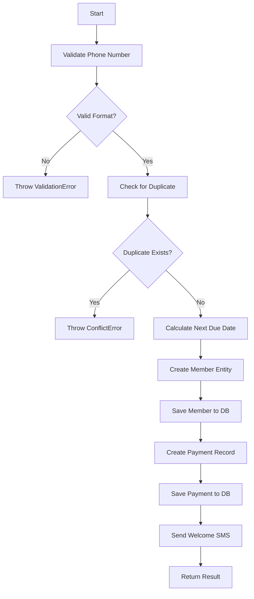
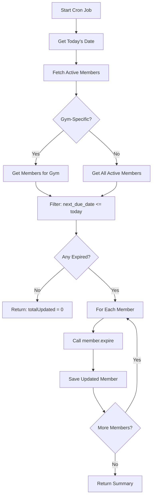
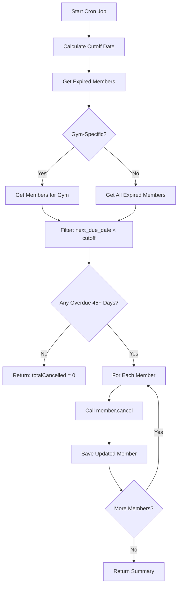
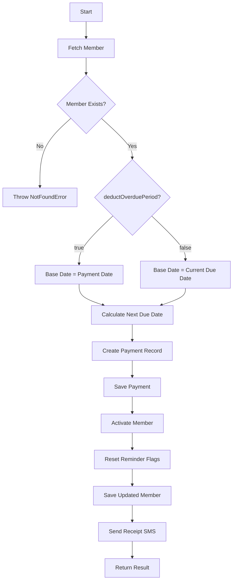
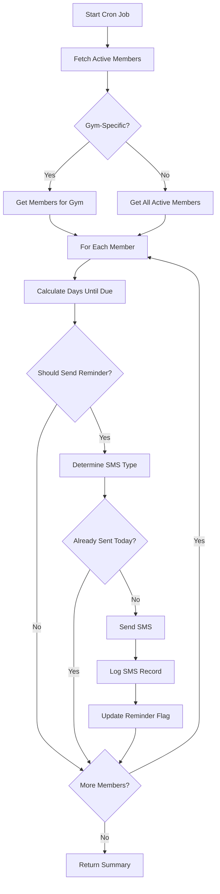

# Use Cases Documentation

## Overview

This document provides detailed documentation for all use cases in the Gym Management SaaS Clean Architecture implementation.

## Table of Contents

1. [Member Use Cases](#member-use-cases)
   - [RegisterMember](#registermember)
   - [UpdateExpiredStatus](#updateexpiredstatus)
   - [CancelOverdueMembers](#canceloverduemembers)
2. [Payment Use Cases](#payment-use-cases)
   - [CollectPayment](#collectpayment)
3. [Reminder Use Cases](#reminder-use-cases)
   - [SendAutomatedReminders](#sendautomatedreminders)

---

## Member Use Cases

### RegisterMember

**File**: `src/core/use-cases/member/RegisterMember.ts`

**Purpose**: Orchestrates the complete member registration workflow including validation, payment recording, and welcome SMS.

#### Dependencies

```typescript
constructor(
  private readonly memberRepo: IMemberRepository,
  private readonly paymentRepo: IPaymentRepository,
  private readonly smsProvider: ISMSProvider
)
```

#### Input

```typescript
interface RegisterMemberInput {
  gymId: string;
  name: string;
  phoneNumber: string;
  planType: PlanType;
  planAmount: number;
  discountId?: string | null;
  recurringDiscount?: boolean;
  membershipStartDate: Date;
  paymentAmount: number;
}
```

#### Output

```typescript
interface RegisterMemberOutput {
  member: Member;
  payment: Payment;
}
```

#### Workflow



#### Detailed Steps

1. **Phone Number Validation**
   ```typescript
   const phoneNumber = PhoneNumber.create(input.phoneNumber);
   // Validates and normalizes: "0771234567" → "+94771234567"
   ```

2. **Duplicate Check**
   ```typescript
   const existingMember = await this.memberRepo.findByPhoneNumber(
     phoneNumber.getValue(),
     input.gymId
   );
   if (existingMember) {
     throw new ConflictError(
       `A member with phone number ${phoneNumber.getDisplayValue()} already exists`
     );
   }
   ```

3. **Calculate Next Due Date**
   ```typescript
   const nextDueDate = calculateNextDueDate(
     input.membershipStartDate,
     input.planType,
     { deductOverduePeriod: true }
   );
   ```

4. **Create Member Entity**
   ```typescript
   const member = Member.create({
     gymId: input.gymId,
     name: input.name,
     phoneNumber: phoneNumber.getValue(),
     planType: input.planType,
     planAmount: input.planAmount,
     discountId: input.discountId || null,
     recurringDiscount: input.recurringDiscount ?? false,
     membershipStartDate: input.membershipStartDate,
     nextDueDate,
     status: MemberStatus.Active,
     sevenDayReminderSent: false,
     threeDayReminderSent: false,
     dueTodayReminderSent: false,
   });
   ```

5. **Save Member**
   ```typescript
   const savedMember = await this.memberRepo.create(member);
   ```

6. **Create Payment Record**
   ```typescript
   const payment = Payment.create({
     memberId: savedMember.id,
     gymId: input.gymId,
     paymentDate: input.membershipStartDate,
     paymentAmount: input.paymentAmount,
     planAmount: input.planAmount,
     discountId: input.discountId || null,
     nextDueDate,
   });

   const savedPayment = await this.paymentRepo.create(payment);
   ```

7. **Send Welcome SMS** (fire-and-forget)
   ```typescript
   this.sendWelcomeSMS(savedMember, input.paymentAmount)
     .catch((error) => {
       console.error('Welcome SMS failed:', error);
     });
   ```

#### Usage Example

```typescript
// In API route
export async function POST(request: NextRequest) {
  const gymProfile = await getCurrentGymProfile();
  const validatedData = addMemberSchema.parse(await request.json());

  const container = await getContainer();
  const registerMember = container.getRegisterMemberUseCase();

  const result = await registerMember.execute({
    gymId: gymProfile.id,
    name: validatedData.name,
    phoneNumber: validatedData.phoneNumber,
    planType: validatedData.planType as PlanType,
    planAmount: validatedData.planAmount,
    discountId: validatedData.discountId,
    recurringDiscount: validatedData.recurringDiscount,
    membershipStartDate: new Date(validatedData.membershipStartDate),
    paymentAmount: validatedData.paymentAmount,
  });

  return NextResponse.json(
    ResponseBuilder.success(result.member.toDatabase()),
    { status: 201 }
  );
}
```

#### Error Handling

| Error Type | When | HTTP Status | Response |
|-----------|------|-------------|----------|
| `ValidationError` | Invalid phone number format | 400 | `{ error: "Invalid phone number format" }` |
| `ConflictError` | Duplicate phone number | 409 | `{ error: "A member with phone number (077) 123-4567 already exists" }` |
| `DatabaseError` | DB operation fails | 500 | `{ error: "Failed to register member" }` |

#### SMS Template (Welcome)

```
Welcome to [GYM_NAME]! 🎉

Your membership is now active.
Next payment due: [DD/MM/YYYY]
Amount: LKR [AMOUNT]

Thank you for joining us!
```

---

### UpdateExpiredStatus

**File**: `src/core/use-cases/member/UpdateExpiredStatus.ts`

**Purpose**: Automated cron job that transitions active members to expired status as soon as their membership lapses (`next_due_date` is today or earlier). There is no grace period.

#### Dependencies

```typescript
constructor(
  private readonly memberRepo: IMemberRepository
)
```

#### Input

```typescript
interface UpdateExpiredStatusInput {
  gymId?: string; // Optional: If provided, only update for specific gym
}
```

#### Output

```typescript
interface UpdateExpiredStatusOutput {
  totalUpdated: number;
  updatedMemberIds: string[];
  errors: string[];
}
```

#### Workflow



#### Detailed Steps

1. **Get Today's Date** (00:00:00 in local timezone)
   ```typescript
   const today = new Date();
   today.setHours(0, 0, 0, 0);
   ```

2. **Fetch Active Members**
   ```typescript
   const members = input.gymId
     ? await this.memberRepo.findActiveMembers(input.gymId)
     : await this.memberRepo.findAllActiveMembers(); // Admin only
   ```

3. **Filter Expired Members**
   ```typescript
   const expiredMembers = members.filter((member) => {
     return member.status === MemberStatus.Active &&
            member.nextDueDate <= today; // due today or earlier — no grace period
   });
   ```

4. **Transition to Expired**
   ```typescript
   for (const member of expiredMembers) {
     try {
       const expiredMember = member.expire();
       await this.memberRepo.update(expiredMember);
       results.totalUpdated++;
       results.updatedMemberIds.push(member.id);
     } catch (error) {
       results.errors.push(`Failed to expire member ${member.id}: ${error.message}`);
     }
   }
   ```

#### Usage Example (Cron Job)

```typescript
// In /api/cron/update-expired-status/route.ts
export async function POST(request: NextRequest) {
  // Verify cron secret
  const authHeader = request.headers.get('authorization');
  if (authHeader !== `Bearer ${process.env.CRON_SECRET}`) {
    return NextResponse.json(
      ResponseBuilder.unauthorized(),
      { status: 401 }
    );
  }

  const container = await getAdminContainer();
  const updateExpiredStatus = container.getUpdateExpiredStatusUseCase();

  const result = await updateExpiredStatus.execute();

  console.log(`Updated ${result.totalUpdated} members to expired status`);

  return NextResponse.json(
    ResponseBuilder.success(result),
    { status: 200 }
  );
}
```

#### Scheduling

**Vercel Cron**: `0 1 * * *` (Daily at 1:00 AM UTC)

```json
// vercel.json
{
  "crons": [
    {
      "path": "/api/cron/update-expired-status",
      "schedule": "0 1 * * *"
    }
  ]
}
```

#### State Transition

```
Active → Expired
```

**Conditions**:
- Current status is `Active`
- `next_due_date <= today` (00:00:00) — members expire the day their membership lapses; there is no grace period

**Effects**:
- Status changed to `Expired`
- Member cannot check in
- No automatic reminders sent
- Can be reactivated by payment

---

### CancelOverdueMembers

**File**: `src/core/use-cases/member/CancelOverdueMembers.ts`

**Purpose**: Automated cron job that cancels members who have been overdue for 45+ days.

#### Dependencies

```typescript
constructor(
  private readonly memberRepo: IMemberRepository
)
```

#### Input

```typescript
interface CancelOverdueMembersInput {
  gymId?: string; // Optional: If provided, only cancel for specific gym
  overdueDays?: number; // Default: 45
}
```

#### Output

```typescript
interface CancelOverdueMembersOutput {
  totalCancelled: number;
  cancelledMemberIds: string[];
  errors: string[];
}
```

#### Workflow



#### Detailed Steps

1. **Calculate Cutoff Date** (45 days ago from today)
   ```typescript
   const today = new Date();
   today.setHours(0, 0, 0, 0);

   const overdueDays = input.overdueDays ?? 45;
   const cutoffDate = new Date(today);
   cutoffDate.setDate(cutoffDate.getDate() - overdueDays);
   ```

2. **Fetch Expired Members**
   ```typescript
   const members = input.gymId
     ? await this.memberRepo.findExpiredMembers(input.gymId)
     : await this.memberRepo.findAllExpiredMembers(); // Admin only
   ```

3. **Filter Overdue Members**
   ```typescript
   const overdueLongMembers = members.filter((member) => {
     return member.status === MemberStatus.Expired &&
            member.nextDueDate < cutoffDate;
   });
   ```

4. **Cancel Members**
   ```typescript
   for (const member of overdueLongMembers) {
     try {
       const cancelledMember = member.cancel();
       await this.memberRepo.update(cancelledMember);
       results.totalCancelled++;
       results.cancelledMemberIds.push(member.id);
     } catch (error) {
       results.errors.push(`Failed to cancel member ${member.id}: ${error.message}`);
     }
   }
   ```

#### Usage Example (Cron Job)

```typescript
// In /api/cron/cancel-overdue-members/route.ts
export async function POST(request: NextRequest) {
  const authHeader = request.headers.get('authorization');
  if (authHeader !== `Bearer ${process.env.CRON_SECRET}`) {
    return NextResponse.json(
      ResponseBuilder.unauthorized(),
      { status: 401 }
    );
  }

  const container = await getAdminContainer();
  const cancelOverdueMembers = container.getCancelOverdueMembersUseCase();

  const result = await cancelOverdueMembers.execute({
    overdueDays: 45, // Default
  });

  console.log(`Cancelled ${result.totalCancelled} overdue members`);

  return NextResponse.json(
    ResponseBuilder.success(result),
    { status: 200 }
  );
}
```

#### Scheduling

**Vercel Cron**: `0 2 * * *` (Daily at 2:00 AM UTC)

```json
// vercel.json
{
  "crons": [
    {
      "path": "/api/cron/cancel-overdue-members",
      "schedule": "0 2 * * *"
    }
  ]
}
```

#### State Transition

```
Expired → Cancelled
```

**Conditions**:
- Current status is `Expired`
- `next_due_date < (today - 45 days)`

**Effects**:
- Status changed to `Cancelled` (terminal state)
- Member cannot be reactivated (must re-register)
- No further reminders sent
- Historical data preserved for reporting

---

## Payment Use Cases

### CollectPayment

**File**: `src/core/use-cases/payment/CollectPayment.ts`

**Purpose**: Handles payment collection and member renewal. This is a **REVENUE-CRITICAL** use case.

#### Dependencies

```typescript
constructor(
  private readonly memberRepo: IMemberRepository,
  private readonly paymentRepo: IPaymentRepository,
  private readonly smsProvider: ISMSProvider
)
```

#### Input

```typescript
interface CollectPaymentInput {
  gymId: string;
  memberId: string;
  paymentDate: Date;
  paymentAmount: number;
  planAmount?: number; // Optional: If different from member's plan amount
  discountId?: string | null;
  deductOverduePeriod?: boolean; // Default: true
}
```

#### Output

```typescript
interface CollectPaymentOutput {
  member: Member;
  payment: Payment;
}
```

#### Workflow



#### Detailed Steps

1. **Fetch Member**
   ```typescript
   const member = await this.memberRepo.findById(input.memberId, input.gymId);
   if (!member) {
     throw new NotFoundError('Member not found');
   }
   ```

2. **Determine Base Date for Calculation**
   ```typescript
   const deductOverdue = input.deductOverduePeriod ?? true;
   const baseDate = deductOverdue
     ? input.paymentDate
     : member.nextDueDate;
   ```

   **Example**:
   - Original due date: 2024-01-15
   - Payment date: 2024-02-01 (17 days overdue)
   - Monthly plan

   If `deductOverduePeriod = true`:
   - Base date = 2024-02-01
   - Next due date = 2024-03-01
   - **Penalty**: Lost 17 days

   If `deductOverduePeriod = false`:
   - Base date = 2024-01-15
   - Next due date = 2024-02-15
   - **No penalty**: Full month from original due date

3. **Calculate Next Due Date**
   ```typescript
   const nextDueDate = calculateNextDueDate(baseDate, member.planType, {
     deductOverduePeriod: input.deductOverduePeriod,
   });
   ```

4. **Create Payment Record**
   ```typescript
   const payment = Payment.create({
     memberId: member.id,
     gymId: input.gymId,
     paymentDate: input.paymentDate,
     paymentAmount: input.paymentAmount,
     planAmount: input.planAmount ?? member.planAmount,
     discountId: input.discountId ?? member.discountId,
     nextDueDate,
   });

   const savedPayment = await this.paymentRepo.create(payment);
   ```

5. **Activate Member** (state machine enforced)
   ```typescript
   let updatedMember = member.activate(nextDueDate);
   ```

   **State Transitions**:
   - Expired → Active ✅
   - Frozen → Active ✅
   - Suspended → Active ✅
   - Cancelled → Active ❌ (throws InvalidStatusTransitionError)

6. **Reset Reminder Flags** for new billing period
   ```typescript
   updatedMember = updatedMember.resetReminderFlags();
   ```

   This ensures reminders are sent again in the new billing cycle.

7. **Save Updated Member**
   ```typescript
   const savedMember = await this.memberRepo.update(updatedMember);
   ```

8. **Send Receipt SMS** (fire-and-forget)
   ```typescript
   this.sendReceiptSMS(savedMember, input.paymentAmount, nextDueDate)
     .catch((error) => {
       console.error('Receipt SMS failed:', error);
     });
   ```

#### Usage Example

```typescript
// In /api/members/[id]/payment/route.ts
export async function POST(
  request: NextRequest,
  { params }: { params: Promise<{ id: string }> }
) {
  const { id } = await params;
  const gymProfile = await getCurrentGymProfile();
  const validatedData = collectPaymentSchema.parse(await request.json());

  const container = await getContainer();
  const collectPayment = container.getCollectPaymentUseCase();

  const result = await collectPayment.execute({
    gymId: gymProfile.id,
    memberId: id,
    paymentDate: new Date(validatedData.paymentDate),
    paymentAmount: validatedData.paymentAmount,
    planAmount: validatedData.planAmount,
    discountId: validatedData.discountId,
    deductOverduePeriod: validatedData.deductOverduePeriod ?? true,
  });

  return NextResponse.json(
    ResponseBuilder.success({
      member: result.member.toDatabase(),
      payment: result.payment.toDatabase(),
    }),
    { status: 201 }
  );
}
```

#### Error Handling

| Error Type | When | HTTP Status | Response |
|-----------|------|-------------|----------|
| `NotFoundError` | Member not found | 404 | `{ error: "Member not found" }` |
| `InvalidStatusTransitionError` | Cannot activate cancelled member | 400 | `{ error: "Invalid status transition: cancelled → active" }` |
| `DatabaseError` | DB operation fails | 500 | `{ error: "Failed to collect payment" }` |

#### SMS Template (Receipt)

```
Payment Received! 💳

Amount: LKR [AMOUNT]
Next Due Date: [DD/MM/YYYY]

Thank you for your payment!
- [GYM_NAME]
```

#### Business Rules

1. **Default Behavior**: `deductOverduePeriod = true` (penalty for late payment)
2. **Grace Period**: Gyms can choose to waive penalty by setting `deductOverduePeriod = false`
3. **Cancelled Members**: Cannot be reactivated via payment (must re-register)
4. **Discount Handling**:
   - If `discountId` provided, use that discount
   - Otherwise, use member's existing `discountId`
   - If `recurringDiscount = true`, discount auto-applies to future payments

---

## Reminder Use Cases

### SendAutomatedReminders

**File**: `src/core/use-cases/reminder/SendAutomatedReminders.ts`

**Purpose**: Sends payment reminders to active members based on plan-specific business rules.

#### Dependencies

```typescript
constructor(
  private readonly memberRepo: IMemberRepository,
  private readonly smsRepo: ISMSRepository,
  private readonly smsProvider: ISMSProvider
)
```

#### Input

```typescript
interface SendAutomatedRemindersInput {
  gymId?: string; // Optional: If provided, only send for specific gym
}
```

#### Output

```typescript
interface ReminderSummary {
  totalSent: number;
  byType: Record<SMSType, number>; // { '7-day': 5, '3-day': 8, 'due-today': 3 }
  errors: string[];
}
```

#### Workflow



#### Detailed Steps

1. **Fetch Active Members**
   ```typescript
   const members = input.gymId
     ? await this.memberRepo.findActiveMembers(input.gymId)
     : await this.memberRepo.findAllActiveMembers(); // Admin only
   ```

2. **For Each Member, Calculate Days Until Due**
   ```typescript
   for (const member of members) {
     const daysUntilDue = getDaysUntilDue(member.nextDueDate);

     // daysUntilDue examples:
     // 7 → Send 7-day reminder
     // 3 → Send 3-day reminder
     // 0 → Send due-today reminder
     // -1 → Overdue (don't send reminder)
   }
   ```

3. **Check if Reminder Should Be Sent** (Plan-Specific Rules)
   ```typescript
   if (!shouldSendReminder(member.planType, daysUntilDue)) {
     continue; // Skip this member
   }
   ```

   **Reminder Rules** (from `ReminderConfig.ts`):

   | Plan Type | Reminders Sent |
   |-----------|----------------|
   | Daily | None (too frequent) |
   | Monthly | 3-day, due-today (skip 7-day) |
   | Weekly | 7-day, 3-day, due-today |
   | 3-Months | 7-day, 3-day, due-today |
   | 6-Months | 7-day, 3-day, due-today |
   | Annual | 7-day, 3-day, due-today |
   | Custom | 7-day, 3-day, due-today |

4. **Determine SMS Type**
   ```typescript
   let smsType: SMSType;
   if (daysUntilDue === 7) {
     smsType = '7-day-reminder';
   } else if (daysUntilDue === 3) {
     smsType = '3-day-reminder';
   } else if (daysUntilDue === 0) {
     smsType = 'due-today-reminder';
   } else {
     continue; // Not a reminder day
   }
   ```

5. **Check for Duplicate** (already sent today)
   ```typescript
   const alreadySent = await this.smsRepo.existsForToday(member.id, smsType);
   if (alreadySent) {
     continue; // Don't send duplicate
   }
   ```

6. **Send SMS**
   ```typescript
   const message = this.formatReminderMessage(member, daysUntilDue);

   const result = await this.smsProvider.send({
     to: member.phoneNumber,
     message,
   });

   if (result.success) {
     summary.totalSent++;
     summary.byType[smsType]++;
   }
   ```

7. **Log SMS Record**
   ```typescript
   await this.smsRepo.create({
     memberId: member.id,
     smsType,
     phoneNumber: member.phoneNumber,
     message,
     deliveryStatus: result.success ? 'sent' : 'failed',
     externalId: result.messageId,
   });
   ```

8. **Update Reminder Flag** (prevent duplicate sends)
   ```typescript
   let updatedMember = member;
   if (smsType === '7-day-reminder') {
     updatedMember = member.markSevenDayReminderSent();
   } else if (smsType === '3-day-reminder') {
     updatedMember = member.markThreeDayReminderSent();
   } else if (smsType === 'due-today-reminder') {
     updatedMember = member.markDueTodayReminderSent();
   }

   await this.memberRepo.update(updatedMember);
   ```

#### Usage Example (Cron Job)

```typescript
// In /api/cron/send-reminders/route.ts
export async function POST(request: NextRequest) {
  const authHeader = request.headers.get('authorization');
  if (authHeader !== `Bearer ${process.env.CRON_SECRET}`) {
    return NextResponse.json(
      ResponseBuilder.unauthorized(),
      { status: 401 }
    );
  }

  const container = await getAdminContainer();
  const sendReminders = container.getSendAutomatedRemindersUseCase();

  const summary = await sendReminders.execute();

  console.log(`Sent ${summary.totalSent} reminders:`);
  console.log(`  - 7-day: ${summary.byType['7-day-reminder']}`);
  console.log(`  - 3-day: ${summary.byType['3-day-reminder']}`);
  console.log(`  - Due today: ${summary.byType['due-today-reminder']}`);

  return NextResponse.json(
    ResponseBuilder.success(summary),
    { status: 200 }
  );
}
```

#### Scheduling

**Vercel Cron**: `0 */6 * * *` (Every 6 hours)

```json
// vercel.json
{
  "crons": [
    {
      "path": "/api/cron/send-reminders",
      "schedule": "0 */6 * * *"
    }
  ]
}
```

**Why every 6 hours?**
- Ensures reminders sent even if member pays after midnight
- Multiple opportunities per day to send due-today reminder
- Idempotent: Won't send duplicates (checked via SMS log)

#### SMS Templates

**7-Day Reminder**:
```
Hi [NAME]! 📅

Your membership payment is due in 7 days.
Due Date: [DD/MM/YYYY]
Amount: LKR [AMOUNT]

Please renew on time to avoid interruption.
- [GYM_NAME]
```

**3-Day Reminder**:
```
Hi [NAME]! ⏰

Your membership payment is due in 3 days.
Due Date: [DD/MM/YYYY]
Amount: LKR [AMOUNT]

Please renew soon to continue your membership.
- [GYM_NAME]
```

**Due Today Reminder**:
```
Hi [NAME]! 🔔

Your membership payment is due TODAY.
Due Date: [DD/MM/YYYY]
Amount: LKR [AMOUNT]

Please renew today to avoid expiration.
- [GYM_NAME]
```

#### Business Rules

1. **Daily Plans**: No automatic reminders (too frequent, payments due every day)
2. **Monthly Plans**: Skip 7-day reminder (payment cycle too short)
3. **All Other Plans**: Full reminder sequence (7-day, 3-day, due-today)
4. **Idempotency**: Each reminder sent only once per billing cycle
5. **Overdue Members**: No reminders sent (status will change to expired)
6. **Reset on Payment**: All reminder flags reset when payment collected

#### Error Handling

- **SMS Send Failures**: Logged but don't stop processing other members
- **Database Errors**: Logged and included in error summary
- **Partial Failures**: Continue processing, return summary with error count

#### Monitoring

Track these metrics:
- Total reminders sent per day
- Breakdown by type (7-day, 3-day, due-today)
- Send success rate
- Error count and types
- Average processing time

---

## Common Patterns

### Pattern 1: Fire-and-Forget SMS

Many use cases send SMS notifications as a side effect. These are **non-blocking** and failures don't stop the main workflow:

```typescript
// Send SMS without awaiting
this.sendWelcomeSMS(member, amount)
  .catch((error) => {
    console.error('SMS failed:', error);
    // Continue execution - SMS failure is not critical
  });
```

### Pattern 2: Idempotency

Use cases that run on schedules (cron jobs) must be idempotent:

```typescript
// Check if already sent today
const alreadySent = await this.smsRepo.existsForToday(memberId, smsType);
if (alreadySent) {
  return; // Skip - already processed
}

// Process and log
await process();
await this.smsRepo.create(logRecord);
```

### Pattern 3: State Machine Transitions

Always use entity methods for state changes (enforces valid transitions):

```typescript
// ❌ BAD: Direct property mutation
member.status = MemberStatus.Active;

// ✅ GOOD: Entity method (enforces state machine)
const activeMember = member.activate(nextDueDate);
```

### Pattern 4: Error Accumulation

Batch operations accumulate errors instead of failing fast:

```typescript
const results = {
  totalProcessed: 0,
  errors: [] as string[],
};

for (const item of items) {
  try {
    await process(item);
    results.totalProcessed++;
  } catch (error) {
    results.errors.push(`Failed to process ${item.id}: ${error.message}`);
  }
}

return results; // Return summary with partial success
```

---

## Testing Use Cases

### Unit Test Template

```typescript
import { RegisterMember } from '@/core/use-cases/member/RegisterMember';
import { MockMemberRepository } from '@/tests/mocks/MockMemberRepository';
import { MockPaymentRepository } from '@/tests/mocks/MockPaymentRepository';
import { MockSMSProvider } from '@/infrastructure/sms/providers/MockSMSProvider';

describe('RegisterMember', () => {
  let useCase: RegisterMember;
  let mockMemberRepo: MockMemberRepository;
  let mockPaymentRepo: MockPaymentRepository;
  let mockSmsProvider: MockSMSProvider;

  beforeEach(() => {
    mockMemberRepo = new MockMemberRepository();
    mockPaymentRepo = new MockPaymentRepository();
    mockSmsProvider = new MockSMSProvider();

    useCase = new RegisterMember(
      mockMemberRepo,
      mockPaymentRepo,
      mockSmsProvider
    );
  });

  it('should register member with initial payment', async () => {
    const input = {
      gymId: 'gym_123',
      name: 'John Doe',
      phoneNumber: '0771234567',
      planType: PlanType.Monthly,
      planAmount: 5000,
      membershipStartDate: new Date('2024-01-01'),
      paymentAmount: 5000,
    };

    const result = await useCase.execute(input);

    expect(result.member.name).toBe('John Doe');
    expect(result.member.status).toBe(MemberStatus.Active);
    expect(result.payment.paymentAmount).toBe(5000);
    expect(mockSmsProvider.sentMessages).toHaveLength(1);
  });

  it('should reject duplicate phone number', async () => {
    // Setup: Add existing member
    mockMemberRepo.addMember({
      ...memberProps,
      phoneNumber: '+94771234567',
    });

    const input = {
      ...inputProps,
      phoneNumber: '0771234567', // Same number, different format
    };

    await expect(useCase.execute(input))
      .rejects.toThrow(ConflictError);
  });
});
```

### Integration Test Template

```typescript
import { createTestContainer } from '@/tests/helpers/createTestContainer';

describe('RegisterMember Integration', () => {
  let container: Container;

  beforeAll(async () => {
    container = await createTestContainer(); // Uses test database
  });

  afterEach(async () => {
    await cleanupTestDatabase();
  });

  it('should register member and persist to database', async () => {
    const useCase = container.getRegisterMemberUseCase();

    const result = await useCase.execute(validInput);

    // Verify member persisted
    const memberRepo = container.getMemberRepository();
    const savedMember = await memberRepo.findById(result.member.id, 'gym_123');

    expect(savedMember).toBeDefined();
    expect(savedMember!.name).toBe('John Doe');

    // Verify payment persisted
    const paymentRepo = container.getPaymentRepository();
    const payment = await paymentRepo.findById(result.payment.id);

    expect(payment).toBeDefined();
    expect(payment!.paymentAmount).toBe(5000);
  });
});
```

---

## Performance Considerations

### 1. Batch Operations

For cron jobs processing many records, use batching:

```typescript
const BATCH_SIZE = 100;

for (let i = 0; i < members.length; i += BATCH_SIZE) {
  const batch = members.slice(i, i + BATCH_SIZE);
  await Promise.all(batch.map(member => processMember(member)));
}
```

### 2. Database Query Optimization

Use repository methods that fetch related data in one query:

```typescript
// ❌ BAD: N+1 queries
for (const member of members) {
  const payments = await paymentRepo.findByMemberId(member.id); // N queries
}

// ✅ GOOD: Single query with join
const membersWithPayments = await memberRepo.findAllWithLastPayment(gymId);
```

### 3. SMS Rate Limiting

Implement rate limiting for SMS sends:

```typescript
const MAX_SMS_PER_SECOND = 10;
const delay = (ms: number) => new Promise(resolve => setTimeout(resolve, ms));

for (const member of members) {
  await sendReminder(member);
  await delay(1000 / MAX_SMS_PER_SECOND); // Rate limit
}
```

---

## Monitoring and Observability

### Key Metrics to Track

1. **RegisterMember**:
   - Registrations per day
   - Average registration time
   - Duplicate rejection rate
   - SMS send success rate

2. **CollectPayment**:
   - Payments per day
   - Total revenue
   - Average payment time
   - Payment failure rate
   - SMS send success rate

3. **SendAutomatedReminders**:
   - Total reminders sent per day
   - Breakdown by type (7-day, 3-day, due-today)
   - Send success rate
   - Processing time
   - Error count

4. **UpdateExpiredStatus**:
   - Members expired per day
   - Processing time
   - Error count

5. **CancelOverdueMembers**:
   - Members cancelled per day
   - Processing time
   - Error count

### Logging Best Practices

```typescript
// Start of use case
console.log(`[RegisterMember] Starting registration for ${input.name}`);

// Key checkpoints
console.log(`[RegisterMember] Member created: ${member.id}`);
console.log(`[RegisterMember] Payment recorded: ${payment.id}`);

// Completion
console.log(`[RegisterMember] Registration completed in ${duration}ms`);

// Errors
console.error(`[RegisterMember] Failed:`, error);
```

---

## Summary

This document provides comprehensive documentation for all use cases in the Clean Architecture implementation. Each use case is:

- **Testable**: Pure business logic with dependency injection
- **Maintainable**: Single responsibility, clear workflows
- **Observable**: Structured logging and error handling
- **Scalable**: Idempotent, handles batching, rate limiting
- **Reliable**: Error accumulation, partial success handling

For implementation details on infrastructure adapters and domain entities, see:
- [CLEAN_ARCHITECTURE.md](./CLEAN_ARCHITECTURE.md)
- [TESTING_GUIDE.md](./TESTING_GUIDE.md)
